<div align="center">

# 🚚 Xinfei Logistics TMS

<p>
  <b>An Open-Source Transportation Management System (TMS) for carriers &amp; forwarders</b><br/>
  <span>Full-process closed loop · 4-end synergy · Microservices · Ready to run</span>
</p>

<p>
  
  
  
  
  
  
  
  
  
  
  
  
  
  
  
  
  
  
  
  
  
  
  
  
  
  
  
  
</p>

</div>

<p align="center"><a href="README.md">简体中文</a> · <b>English</b></p>

> *Xinfei TMS — Open-source Transportation Management System with 4-end synergy, powered by JDK 25 + Spring Boot 4.1.1 + Vue 3.5.*

> **Xinfei TMS** is a **4-end synergistic** (Admin + Customer + Courier + Driver) open-source Transportation Management System built on **JDK 25 + Spring Boot 4.1.1 + Vue 3.5**, covering the full chain: booking → order → intelligent dispatch → operations → tracking → proof of delivery. Drools rule engine drives intelligent dispatch, Netty powers self-built GPS tracking ingestion, Sa-Token provides multi-tenant SaaS readiness — order management, load planning, dispatch, driving management, GPS vehicle tracking and data reporting, all in one system for operational efficiency and cost control.

<p align="center">
<b><a href="#sec-tech"><code>14</code></a></b> microservices · <b><code>4</code></b> apps · <b><code>101</code></b> functional requirements · <b><code>55</code></b> database tables · <b><code>27</code></b> technologies · full business closed loop
</p>

<p align="center">
🔗 <b>Live demo</b>: <a href="https://itxinfei.github.io/xinfei-tms/" target="_blank">https://itxinfei.github.io/xinfei-tms/</a> ｜ Account <code>admin / 123456</code>
</p>

---

## 📑 Table of Contents

- [1. What &amp; Why](#sec-intro)
- [2. Highlights](#sec-advantages)
- [3. Pain Points We Solve](#sec-pain)
- [4. Four-End Synergy](#sec-ends)
- [5. Feature Overview](#sec-features)
- [6. Technical Solution](#sec-tech)
- [7. Quick Start](#sec-quickstart)
- [8. Screenshots](#sec-screens)
- [9. Documents](#sec-docs)
- [10. Pre-built VM Image](#sec-vm)
- [11. Business Services &amp; Contact](#sec-contact)
- [12. Milestones](#sec-milestones)
- [13. FAQ](#sec-faq)
- [14. Contributing](#sec-contrib)

---

<a id="sec-intro"></a>

## 1. What &amp; Why

The four most common logistics business models are **express, less-than-truckload, dedicated lines and third-party logistics (3PL)**. Regardless of the model, the core pain points are the same: vehicles, drivers and routes are scattered and hard to manage; the transport process is opaque; dispatch and billing rely on manual work; cost and service-level performance cannot be evaluated.

Xinfei TMS was built to solve exactly this — it moves the whole chain of "resource preparation → ordering → dispatch → transport → delivery → POD → settlement" into one system, with comprehensive statistics and evaluation of vehicles, drivers and routes, helping enterprises **improve operational efficiency, reduce transport costs and stay ahead in a competitive market**.

> 💡 **Why this project?** Commercial TMS products are either **too expensive** (annual fees of ¥30K–300K), **too outdated** (JDK 8 + Vue 2), or **too heavy** (6-month implementation cycles). Xinfei TMS aims to be the **third option**: open source and free, full-chain closed loop, cutting-edge stack, 4-end synergy — ready to run out of the box, friendly to secondary development.

---

<a id="sec-advantages"></a>

## 2. ✨ Highlights

### 2.1 Six Differentiators

| # | Highlight | Why others don't have it |
| --- | --- | --- |
| 1 | **4-End Synergy** | Admin + Customer + Courier + Driver apps covering all roles — most open-source TMS only ship an admin console |
| 2 | **JDK 25 + SB 4.1.1 + Vue 3.5** | The most modern stack among similar open-source TMS; most still sit on JDK 8 + SB 2.x + Vue 2 |
| 3 | **Drools + XXL-Job Intelligent Dispatch** | Rule-engine driven dispatch &amp; freight calculation instead of hard-coded if-else; distributed scheduling replaces Quartz |
| 4 | **Netty Self-Built Tracking Ingestion** | No third-party SDK dependency; independent `xfwl-netty` microservice for high-concurrency device access |
| 5 | **Sa-Token Multi-Tenancy** | SaaS-ready — one codebase serving multiple tenants |
| 6 | **Clear Evolution Roadmap** | Kafka → TDengine/鹰眼 → OR-Tools → Spring AI planned; this is not a "ship and stop" project |

### 2.2 Who Is It For?

- 🚛 **Small &amp; medium fleets** (10–50 vehicles): want digitalization but cannot afford ¥30K–300K annual fees
- 🚀 **Logistics startups**: need a feature-complete, modern-stack, runnable 4-end TMS as an MVP
- 📚 **Java learners**: one codebase to practice microservices + rule engine + Netty + multi-tenancy
- 🔧 **Secondary developers**: deliver customized solutions to clients, saving 3 months of groundwork

### 2.3 Comparison

| Capability | Xinfei TMS | Similar open-source TMS | Commercial TMS |
| --- | --- | --- | --- |
| 4-end synergy (Admin+Customer+Courier+Driver) | ✅ | ❌ admin only | ✅ |
| JDK 25 + Spring Boot 4.1 | ✅ | ❌ mostly JDK 8 | partially |
| Multi-tenant SaaS | ✅ | ❌ | ✅ |
| Intelligent dispatch (Drools) | ✅ | ❌ if-else | ✅ |
| Netty self-built tracking ingestion | ✅ | ❌ | ✅ |
| Annual fee | **0 (learning/research)**; commercial use requires license | 0 | **¥30K–300K** |
| Freedom to customize | ✅ source-available (free for personal learning/research, commercial use requires license) | ✅ | ❌ black box |

> "Similar open-source TMS" refers to mainstream open-source TMS projects on Gitee/GitHub in general, not any specific project; corrections are welcome via Issue.

### 2.4 See It In Action

<table>
<tr>
<td align="center" width="50%">
  
  <br/><sub><b>Admin Login</b> · unified account + captcha</sub>
</td>
<td align="center" width="50%">
  
  <br/><sub><b>Dashboard</b> · orders / alarms / todos &amp; charts</sub>
</td>
</tr>
</table>

### 2.5 Feature Progress Matrix

|  |  |  |  |
| --- | --- | --- | --- |
| ✅ Order Management | ✅ Intelligent Dispatch | ✅ Operations | ✅ Tracking |
| ✅ Multi-Tenant Auth | ✅ Master Data | ✅ Waybill | ✅ Reports |
| ✅ 4-End Apps | ✅ Permission / Menu | ✅ Vehicle / Route | ✅ Personnel |
| 🔲 Settlement | 🔲 OR-Tools Route Planning | 🔲 POD OCR | 🔲 Dynamic ETA |
| 🔲 AI Assistant (Spring AI) | 🔲 ES Search | 🔲 MinIO Object Storage | 🔲 Kafka Pipeline |

---

<a id="sec-pain"></a>

## 3. 🎯 Pain Points We Solve

| Industry pain point | How Xinfei TMS solves it |
| --- | --- |
| Vehicles / drivers / routes scattered, hard to evaluate | Centralized master data + multi-dimensional reports |
| Manual dispatch, experience-based load planning | Scheduled dispatch + route planning auto-generating transport tasks &amp; trips |
| Opaque in-transit process | GPS vehicle tracking + track replay, real-time status query |
| Opaque freight calculation, error-prone | Drools dynamic rule engine — configurable &amp; auditable billing rules |
| Customers have no way to track, no POD evidence | Customer app tracking + electronic POD / receipt evidence |
| Data silos, manual statistics | Data aggregation + real-time analysis, automatic business reports |

---

<a id="sec-ends"></a>

## 4. 📱 Four-End Synergy

| End | Name | Users | Core capabilities |
| --- | --- | --- | --- |
| Admin Console | Xinfei TMS Admin | Internal admins | Master data, order management, waybill management |
| Customer App | **Xinfei Express** | External customers | Booking, shipment tracking |
| Courier App | **Xinfei Courier** | Internal couriers | Pickup &amp; delivery tasks |
| Driver App | **Xinfei Driver** | Internal drivers | Transport tasks, location reporting |

---

<a id="sec-features"></a>

## 5. 🔍 Feature Overview

### 5.1 End-to-End Business Flow


```
Booking 📦 → Order creation 📋 → Intelligent dispatch 🤖 (Drools) → Driver accepts 🚚
→ Operations ⚙️ → Tracking 📍 (Netty) → POD ✅ → Settlement 💰
```

### 5.2 Core Modules

| Module | Description |
| --- | --- |
| **Order Management** | Booking, cargo management, full lifecycle status, freight estimation |
| **Intelligent Dispatch** | Order classification, route planning, transport task creation, trip/vehicle/driver assignment |
| **Transport Management** | Task execution, driver job sheets, in-transit status tracking |
| **GPS Tracking / Monitoring** | Real-time vehicle location, track replay, deviation &amp; anomaly alerts |
| **Delivery Execution** | Pickup/delivery tasks, waybill management, electronic POD |
| **Resource Management** | Fleet, vehicle, vehicle type, line, trip maintenance |
| **Personnel Management** | Driver, courier, position &amp; organization management |
| **Customer Portal** | Customer app: booking, tracking, logistics timeline |
| **POD &amp; Settlement** | POD evidence, cost settlement, reconciliation |
| **Data Reports** | Volume, service level, cost, performance statistics |
| **Master Data** | Organization, menu, permission, dictionary |
| **Unified Auth &amp; Permission** | Sa-Token based user / role / menu / multi-tenant auth |

---

<a id="sec-tech"></a>

## 6. 🏗 Technical Solution

### 6.0 Project Structure

```
xinfei-tms/
├── Microservices (14)
│   ├── xfwl-gateway/           # Unified gateway (Spring Cloud Gateway)
│   ├── xfwl-auth/              # Auth center (Sa-Token + multi-tenant)
│   ├── xfwl-base/              # Master data (org / vehicle / line / cargo)
│   ├── xfwl-oms/               # Order management (OMS)
│   ├── xfwl-dispatch/          # Intelligent dispatch (Drools + XXL-Job)
│   ├── xfwl-work/              # Operations (pickup/delivery & transport tasks)
│   ├── xfwl-user/              # Users & members
│   ├── xfwl-file-server/       # Attachments (POD photos upload/view, no DB)
│   ├── xfwl-netty/             # Tracking ingestion (Netty TCP)
│   ├── xfwl-aggregation/       # Data aggregation
│   └── xfwl-web/               # BFF layer (4-end APIs)
│       ├── xfwl-web-manager/   #   Admin BFF
│       ├── xfwl-web-courier/   #   Courier BFF
│       ├── xfwl-web-customer/  #   Customer BFF
│       └── xfwl-web-driver/    #   Driver BFF
├── Support libs (2 jars)
│   ├── xfwl-common/            # Common components (utils / context / interceptors)
│   └── xfwl-service-api/       # Inter-service API contracts (Feign)
├── Frontend (4 ends)
│   ├── xfwl-admin-ui-vue3/     # Admin (Vue3 + Element Plus)
│   └── xfwl-mobile/            # Mobile 3 ends (uni-app Vue3)
│       ├── customer/         #   Customer · Xinfei Express
│       ├── courier/          #   Courier · Xinfei Courier
│       └── driver/           #   Driver · Xinfei Driver
├── deploy/                   # Docker Compose orchestration & deployment scripts
└── docs/                     # Docs + screenshots + badges
```

### 6.1 System Architecture


> Four layers: **Presentation** (Admin Vue3 + mobile uni-app) → **Gateway** (Spring Cloud Gateway, Sa-Token auth + Same-Token anti-direct-access) → **Service** (14 business microservices, Nacos registry/config) → **Data** (MySQL single-db-by-domain + Redis + RabbitMQ).

### 6.2 Microservice Architecture


> Microservices split by business domain: `xfwl-auth`, `xfwl-gateway`, `xfwl-base`, `xfwl-oms`, `xfwl-dispatch`, `xfwl-work`, `xfwl-netty`, `xfwl-aggregation`, etc., communicating via OpenFeign, registered &amp; discovered via Nacos.

### 6.3 Technology Architecture


#### Backend Stack

| Category | Technology | Version | Notes |
|---|---|---|---|
| **Core** | JDK | 25 (LTS) | Virtual threads |
| | Spring Boot | 4.1.1 | Jakarta EE 10 |
| | Spring Cloud | 2025.1.2 | Aligned with Boot 4.1 |
| | Spring Cloud Alibaba | 2025.1.0.0 | Nacos registry/config |
| | Spring Cloud Gateway | 5.0.2 | Reactive (WebFlux) |
| **Persistence** | MyBatis-Plus | 3.5.17 | boot4 starter, MyBatis-Spring 4.0.0 |
| | Druid | 1.2.28 | boot4 starter connection pool |
| | MySQL | 8.0.x | utf8mb4, single-db-by-domain |
| **Auth** | Sa-Token | 1.46.0 | boot4 starter, multi-tenant |
| **Rule Engine** | Drools | 8.38.0.Final | Freight calculation & dispatch rules |
| **Scheduling** | XXL-Job | 2.4.1 | Distributed task scheduling |
| **Others** | FastJSON2 | 2.0.53 | JSON serialization |
| | springdoc-openapi | 3.1.1 | API docs (Boot4 compatible) |
| | MapStruct | 1.6.3 | DTO/Entity mapping |
| | Lombok | 1.18.42 | Annotation processor |
| | EasyExcel | 3.3.4 | Excel import/export |
| | EasyCaptcha | 1.6.2 | Login captcha |

#### Middleware

| Middleware | Version | Port | Purpose |
|---|---|---|---|
| MySQL | 8.0.46 | 3306 | Business database |
| Redis | 7.x | 6379 | Cache + session |
| Nacos | 2.3.2 | 8848 / 9848 | Registry + config center |
| RabbitMQ | 3.12 | 5672 / 15672 | Message bus |
| XXL-Job | 2.4.1 | 8090 | Distributed scheduling |

#### Frontend Stack

| App | Technology | Notes |
|---|---|---|
| Admin | Vue 3.5 + Vite + Element Plus + Pinia + ECharts | Management console |
| Driver | uni-app Vue3 + uview-plus | H5 mobile app |
| Courier | uni-app Vue3 + uview-plus | H5 mobile app |
| Customer | uni-app Vue3 + uview-plus | H5 mobile app |

### 6.4 Tech Highlights

#### 6.4.1 Landed

| Technology | Role in the system |
| --- | --- |
| **JDK 25 Virtual Threads** | Higher throughput on IO-heavy scenarios, lower thread overhead |
| **Drools 8.38 rule engine** | Configurable, hot-reloadable freight &amp; business rules |
| **XXL-Job 2.4.1 distributed scheduling** | Unified orchestration of dispatch &amp; periodic tasks (replaces Quartz) |
| **Sa-Token + JWT multi-tenant auth** | Unified login, stateless auth, multi-tenant &amp; captcha |
| **Spring Cloud Gateway** | Routing, login-state validation &amp; anti-direct-access |
| **Netty** | High-concurrency TCP channel for tracking reporting &amp; device access |
| **Baidu Map** | Address resolution, distance calculation, track display |
| **Druid connection pool** | Connection management &amp; SQL monitoring |

#### 6.4.2 Why These Choices

| Choice | Why not the alternative? |
| --- | --- |
| **Sa-Token** over Shiro | Lighter, native multi-tenancy, complete Chinese docs, no Boot 3 compatibility baggage |
| **XXL-Job** over Quartz | Distributed scheduling with built-in admin console; Quartz means building your own scheduler |
| **Drools** over if-else | Rules are visible, hot-reloadable, no redeploy needed |
| **Single-db-by-domain** over 8 databases | Lower dev/small-scale ops cost; evolve to time-series DB at scale |
| **Resilience4j** over Hystrix | Hystrix is archived; R4 is the Spring Cloud official direction (planned) |

#### 6.4.3 Code Snippets

**Drools dispatch rule** (`xfwl-dispatch`) — rules are configuration, hot-reloaded without redeploy:

```java
rule "same-city order priority"
when
    $order : Order(distanceType == "LOCAL", priority >= 5)
    $driver : Driver(status == "IDLE", city == $order.pickupCity)
then
    $order.assignTo($driver);
end
```

**Netty tracking ingestion** (`xfwl-netty`) — self-built TCP channel, no third-party SDK:

```java
@ChannelHandler.Sharable
public class LocationServerHandler extends SimpleChannelInboundHandler<ByteBuf> {
    @Override
    protected void channelRead0(ChannelHandlerContext ctx, ByteBuf in) {
        // parse location protocol → store track → push to dispatch / monitoring
    }
}
```

#### 6.4.4 Evolution Roadmap (Planned)

Reviewed and approved items, not yet landed; batched by priority (see the refactoring plan &amp; doc 《53》R2):

| Technology | Purpose | Priority |
| --- | --- | --- |
| **MinIO object storage** | POD &amp; signature photos (S3 protocol) | P1 near-term |
| **Zipkin tracing** | Micrometer Tracing + Zipkin call-chain monitoring | P1 near-term |
| **Resilience4j** | Circuit breaker, fallback &amp; rate limiting | P1 near-term |
| **MapStruct** | Compile-time type-safe mapping instead of reflection copy | P1 near-term |
| **Kafka** | Track pipeline (Netty → Kafka → time-series store) | P2 mid-term |
| **Debezium CDC** | binlog change capture, MySQL → Kafka → ES / Doris sync | P2 mid-term |
| **Elasticsearch** | Waybill multi-condition &amp; fuzzy search | P2 mid-term |
| **Google OR-Tools** | VRP optimization (CVRP / VRPTW) for dispatch | P2 mid-term |
| **Apache Doris OLAP** | Reports &amp; analytics, MySQL-protocol compatible | P2 mid-term |
| **Baidu Yingyan** | Track correction &amp; geofencing | P2 mid-term |
| **Spring AI 2.0** | LLM chat / RAG / agent orchestration for smart customer service | P3 long-term |
| **Kuaidi100** | Multi-carrier tracking, e-waybill printing, booking | P3 long-term |
| **Flowable workflow** | Approval flows: exception handling, re-dispatch, reconciliation | P3 long-term |
| **JimuReport** | Visual reports &amp; big-screen dashboards | P3 long-term |

### 6.5 Database Design

After the full refactor the system converges to a **single MySQL database** (`xinfei_tms`), table-prefixed by business domain, splittable per domain at scale:

| Domain | Main tables |
| --- | --- |
| Master data | cargo types, vehicles, fleets, lines, organizations, stations |
| Order (OMS) | orders, cargo info, order locations |
| Operations | pickup/delivery tasks, transport tasks, driver job sheets, waybills |
| Dispatch | order classification, route caches |
| Auth &amp; permission | tenants, users, roles, menus, resources |
| Tracking &amp; location | vehicle tracks &amp; locations (time-series DB planned at scale, see §6.4) |

---

<a id="sec-quickstart"></a>

## 7. 🚀 Quick Start

### 7.1 Environment &amp; Stack

- **Backend**: JDK 25 + Spring Boot 4.1.1 + Spring Cloud 2025.1.2 (Spring Cloud Alibaba 2025.1.0.0), Nacos registry/config, OpenFeign, Spring Cloud Gateway auth, Sa-Token multi-tenant auth, XXL-Job, Drools.
- **Frontend**: Admin `xfwl-admin-ui-vue3` (Vue 3 + Vite + Element Plus + Pinia + ECharts); Mobile uni-app (Vue 3 / Vite + uview-plus) for 3 apps.
- **Storage &amp; middleware**: MySQL (single-db-by-domain), Redis cache, RabbitMQ, Druid; MinIO &amp; ES are planned (see §6.4).
- **Support**: unified auth center (Sa-Token multi-tenant + captcha), gateway anti-direct-access, Netty tracking ingestion.

### 7.2 Run in Five Minutes

```bash
git clone https://gitee.com/itxinfei/xinfei-tms.git
cd xinfei-tms
docker-compose up -d        # start middleware: MySQL / Redis / RabbitMQ / Nacos
# ① Initialize the database: DDL & seed scripts are bundled in the pre-built VM image (see "10. Pre-built VM Image");
#    the sql/ directory is not distributed with this repo — contact the author if needed
# ② start xfwl-auth → xfwl-gateway → business microservices (mvn spring-boot:run or deploy scripts)
# ③ start admin (pnpm i && pnpm dev) and mobile (run uni-app in HBuilderX)
```

> Expected 5–10 minutes. Detailed deployment, config &amp; secondary-development docs: see 「9. Documents」; a pre-built VM image (middleware pre-installed) is available from the author — see 「10. Pre-built VM Image」.

---

<a id="sec-screens"></a>

## 8. 📸 Screenshots

> Screenshots are from a real running environment (updated 2026-10-15). Admin core business pages and the 3 mobile apps are all captured.

### 8.1 Admin Console

<table>
<tr>
<td align="center" width="50%">
  
  <br/><sub><b>Admin Login</b> · unified account + tenant + captcha</sub>
</td>
<td align="center" width="50%">
  
  <br/><sub><b>Dashboard</b> · orders / alarms / todos &amp; charts</sub>
</td>
</tr>
<tr>
<td align="center" width="50%">
  
  <br/><sub><b>Order Management</b> · status filter / paginated list (60 records)</sub>
</td>
<td align="center" width="50%">
  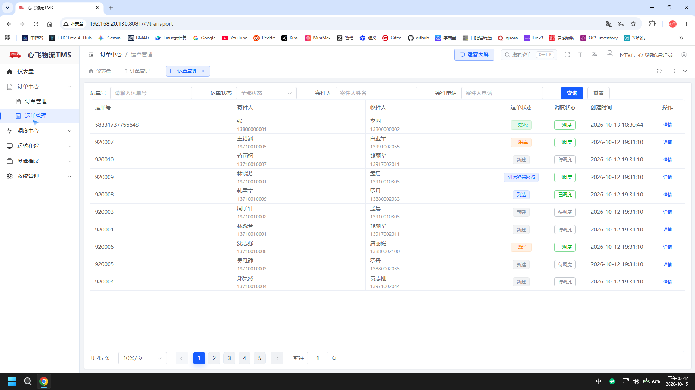
  <br/><sub><b>Waybill Management</b> · waybill status / line haul (45 records)</sub>
</td>
</tr>
<tr>
<td align="center" width="50%">
  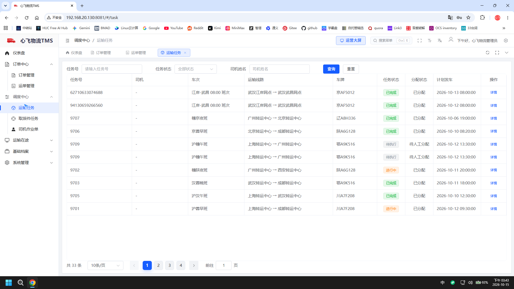
  <br/><sub><b>Transport Tasks</b> · dispatch-generated tasks (33 records)</sub>
</td>
<td align="center" width="50%">
  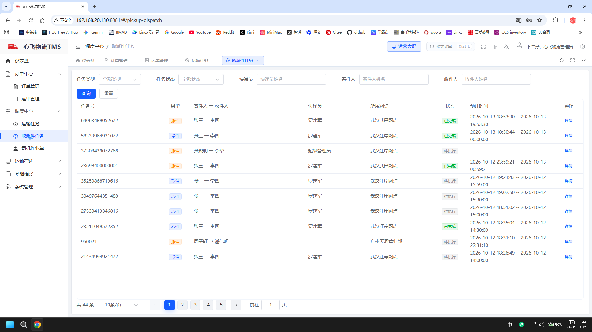
  <br/><sub><b>Pickup/Delivery Tasks</b> · pickup &amp; delivery (44 records)</sub>
</td>
</tr>
<tr>
<td align="center" width="50%">
  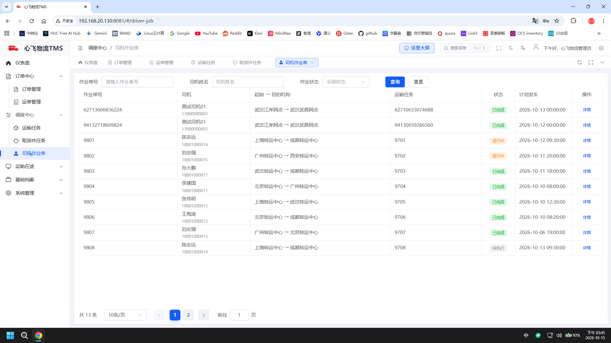
  <br/><sub><b>Driver Jobs</b> · driver pickup / unloading (13 records)</sub>
</td>
<td align="center" width="50%">
  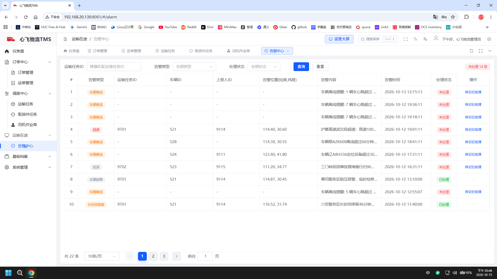
  <br/><sub><b>Alarm Center</b> · deviation / overspeed / offline alarms (22, 14 open)</sub>
</td>
</tr>
<tr>
<td align="center" width="50%">
  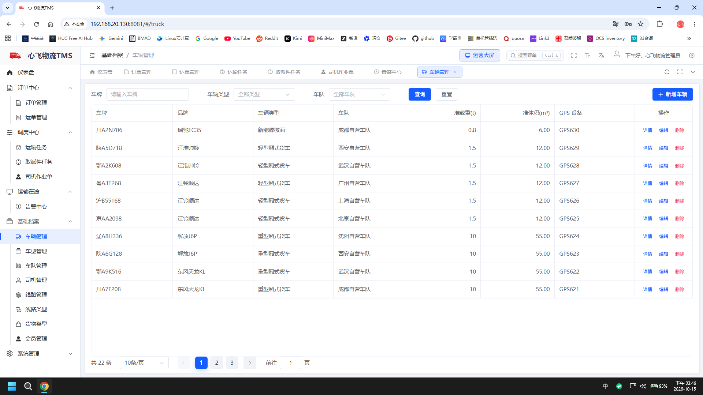
  <br/><sub><b>Truck Management</b> · vehicle profiles &amp; status (22 records)</sub>
</td>
<td align="center" width="50%">
  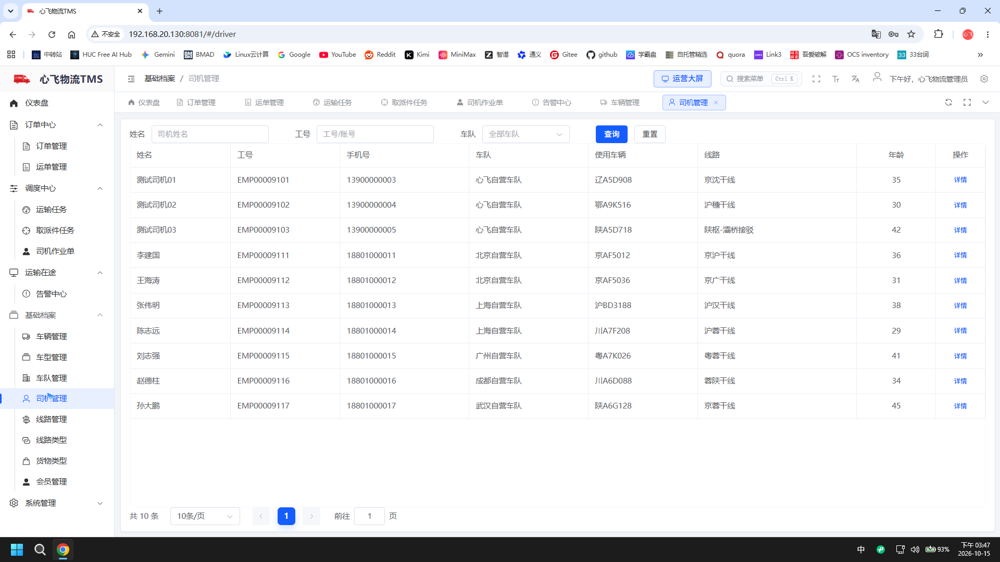
  <br/><sub><b>Driver Management</b> · driver profiles / Xinfei fleet (10 records)</sub>
</td>
</tr>
<tr>
<td align="center" width="50%">
  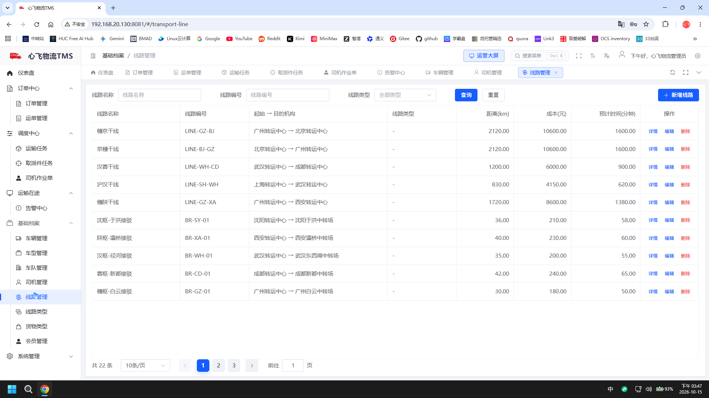
  <br/><sub><b>Line Management</b> · trunk / feeder lines (22 records)</sub>
</td>
<td align="center" width="50%"></td>
</tr>
</table>

### 8.2 Mobile Apps

<table>
<tr>
<td align="center" width="100%">
<b>Customer · Xinfei Express</b> (H5, :8084)<br/><br/>
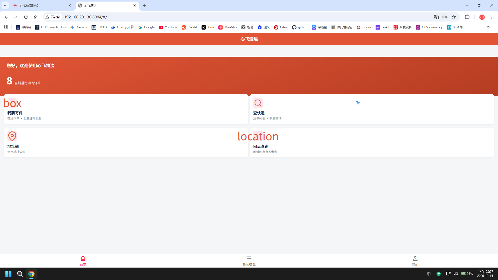
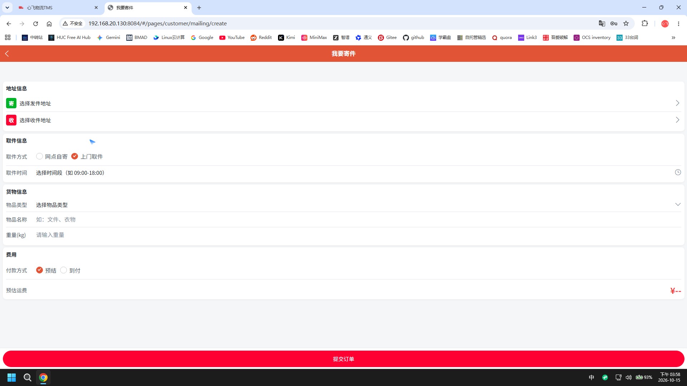
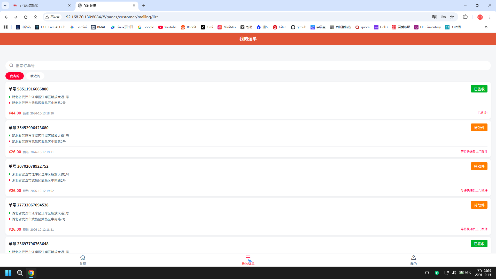
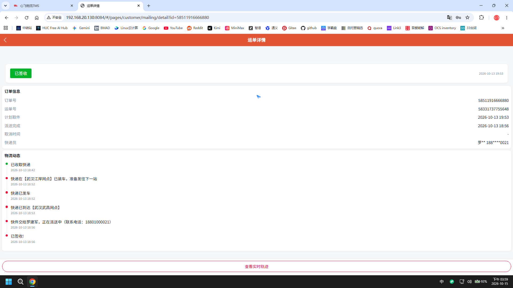
<br/><sub>Home (in-progress orders) · Book a shipment · My waybills · Waybill detail / tracking</sub>
</td>
</tr>
<tr>
<td align="center" width="100%">
<b>Courier · Xinfei Courier</b> (H5, :8083)<br/><br/>
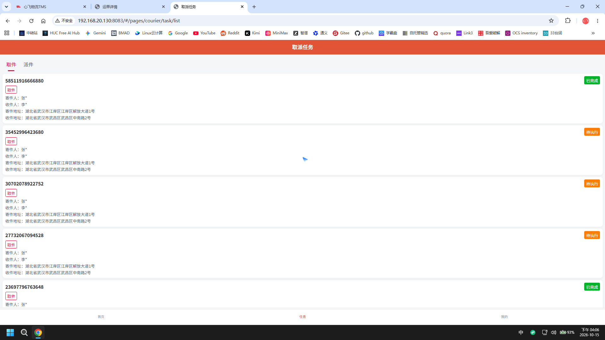
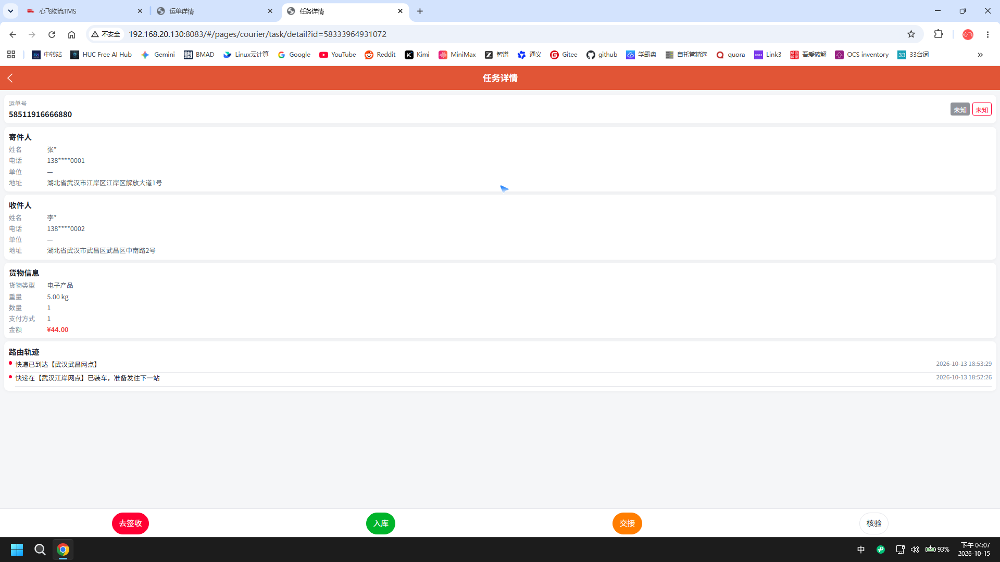
<br/><sub>Pickup/delivery task list · Task detail (sign / inbound / handover / verify)</sub>
</td>
</tr>
<tr>
<td align="center" width="100%">
<b>Driver · Xinfei Driver</b> (H5, :8082)<br/><br/>
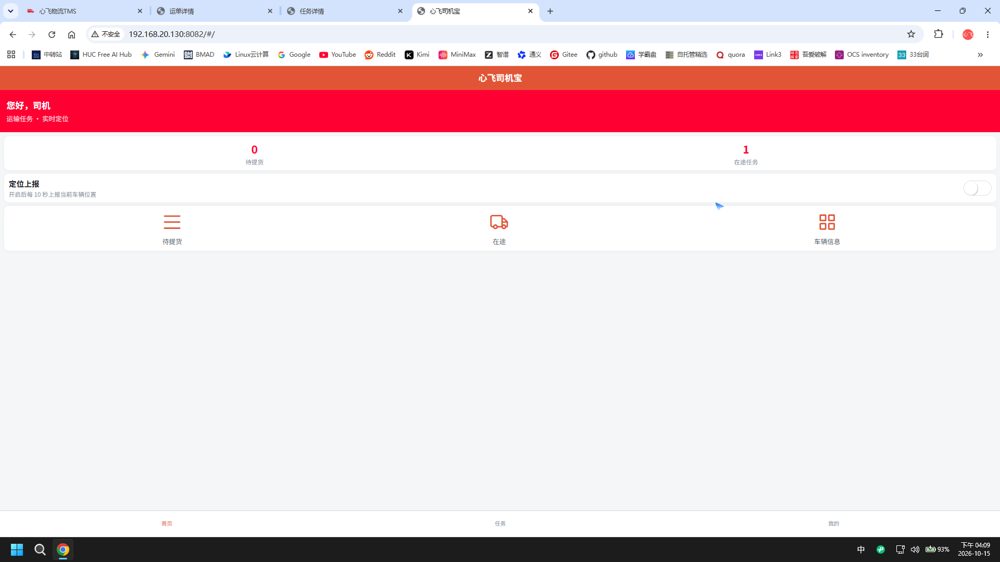
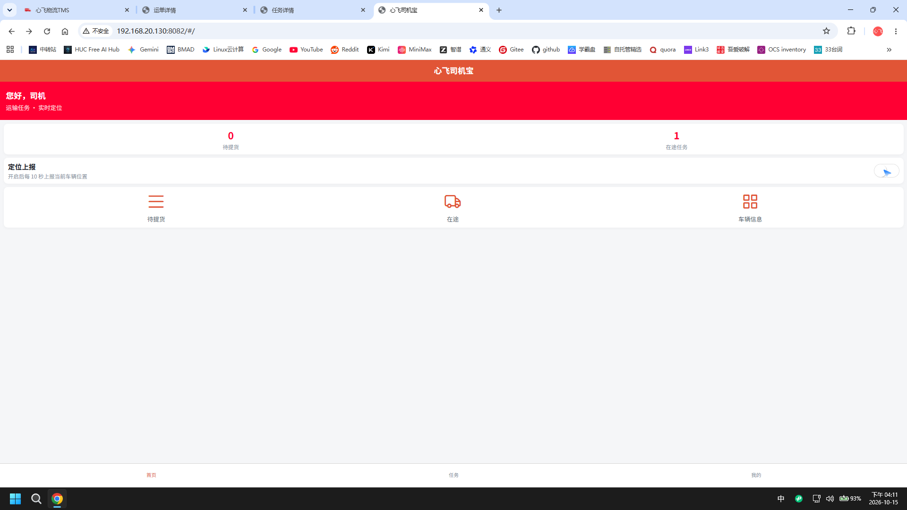
<br/><sub>Home / transport tasks · Location reporting toggle (enabled)</sub>
</td>
</tr>
</table>

### 8.3 Ops &amp; Middleware

<table>
<tr>
<td align="center" width="50%">
  
  <br/><sub><b>Deploy Status</b> · all microservices health monitoring</sub>
</td>
<td align="center" width="50%">
  
  <br/><sub><b>Nacos</b> · registry / config center</sub>
</td>
</tr>
<tr>
<td align="center" width="50%">
  
  <br/><sub><b>RabbitMQ</b> · message queue monitoring</sub>
</td>
<td align="center" width="50%">
  
  <br/><sub><b>XXL-Job</b> · scheduled tasks &amp; reports</sub>
</td>
</tr>
<tr>
<td align="center" width="50%">
  
  <br/><sub><b>Docker</b> · microservice &amp; middleware container health</sub>
</td>
<td align="center" width="50%">
  
  <br/><sub><b>Gitea CI/CD</b> · ordered backend deployment + per-service health checks</sub>
</td>
</tr>
<tr>
<td align="center" width="50%">
  
  <br/><sub><b>MySQL 8.0</b> · direct query · xinfei_tms all 54 tables (InnoDB)</sub>
</td>
<td align="center" width="50%">
  
  <br/><sub><b>Redis 7</b> · Sa-Token session cache &amp; TTL</sub>
</td>
</tr>
</table>

---

<a id="sec-docs"></a>

## 9. 📚 Documents

In-repo resources you can browse directly; internal design documents (requirements, API contracts, data dictionary) are **not distributed with the source repo** — contact the author if needed:

| Resource | Description |
| --- | --- |
| [docs/architecture/](docs/architecture/) | Architecture view sources (business flow / runtime topology / data ownership / order lifecycle .dot diagrams & scripts) |
| [deploy/](deploy/) | One-stop deployment assets: middleware & app Docker Compose, CI/CD workflows, deploy scripts, sanitized .env example |
| [docs/sql/区划数据/](docs/sql/区划数据/) | 4-level administrative division data (CSV) with coordinate / pinyin generation toolchain |
| [docs/brand/](docs/brand/) | Brand assets (full-size logos / favicon) |
| [SECURITY.md](SECURITY.md) · [CODE_OF_CONDUCT.md](CODE_OF_CONDUCT.md) · [CONTRIBUTING.md](CONTRIBUTING.md) | Community files: vulnerability disclosure / code of conduct / contribution guide |
| [LICENSE](LICENSE) | BUSL-1.1 license (free for personal study & research; commercial use requires authorization) |

**Design diagrams** (in `docs/`): `system-arch.png` (system), `microservice-arch.png` (microservices), `tech-arch.png` (technology), `business-flow.png` (business flow).

---

<a id="sec-vm"></a>

## 10. 📦 Pre-built VM Image

> This project's learning &amp; deployment **strongly rely on a pre-built VM image**. Everything needed to run the system is **pre-installed and persisted inside the image** — **all middleware, database data and the full configuration required by the microservices live in this VM**, ready to use out of the box. No external setup or data migration is needed.

### 10.1 What's inside the image (data + config shipped together)

| Category | Component | State inside the image |
| --- | --- | --- |
| Database | MySQL 8.0 | Business DB `xinfei_tms` (all tables + demo data) and scheduler DB `xxl_job`, **persisted on disk** |
| Cache | Redis 7 | Sa-Token sessions / J2Cache L2 cache, `dump.rdb` **persisted** |
| Message queue | RabbitMQ | Exchanges / queues / accounts **persisted** |
| Registry / Config | Nacos | Namespace `pinda-tms`; **all microservice configs (per-service dataIds) are already published in the image** |
| Job scheduling | XXL-Job | Scheduler center + executor config ready |
| Reverse proxy | Nginx | Frontend static assets + backend gateway proxy, **pre-configured in the image** |
| Source / CI | Gitea + Runner | Project source repo and CI/CD pipeline built-in |

### 10.2 Key points

- **Data is part of the image**: MySQL / Redis / RabbitMQ business data, the full Nacos configuration, and each microservice's `.env` are all delivered with the VM — import and run, no dependency on any external service.
- The VM's internal IP is `192.168.20.130` (VMware NAT segment); accessible right after import. To change the IP/segment, see `docs/05-部署文档.md`.
- Default accounts: `pdwl / 123456` (SSH), `MySQL root / 123456`; for the application admin login, see the `docs/` login notes or contact the author.

### 10.3 How to get it

The image is distributed via **Baidu Netdisk**; the link is **not public** — contact the author for the latest address (see Chapter 11).

---

<a id="sec-contact"></a>

## 11. 🤝 Business Services &amp; Contact

<div align="center">

<table>
<tr>
<td align="center" width="50%">

### 11.1 🛠️ Paid Technical Services

This project is licensed under **BUSL-1.1**: free for personal learning, research, teaching and graduation projects; commercial use (production, private deployment, providing services, etc.) requires a commercial license from the author. The author also offers commercial support:

- 🔧 **Secondary development / customization** (platform integration, new features, UI adjustments)
- 🚀 **Private deployment delivery** (server, domain, environment, incl. VM image)
- 🎓 **Project walkthrough / thesis Q&amp;A** (architecture, source code, interview topics)
- 📦 **Full database init scripts + demo data**
- 💬 Daily technical Q&amp;A &amp; long-term maintenance support

<b>👉 Business contact QQ: <code>747011882</code></b>

</td>
<td align="center" width="50%">

### 11.2 💬 Join the Community


<sub>Scan to follow WeChat official account 「心飞为你飞」</sub>

<br>

🔗 Repo: [gitee.com/itxinfei/xinfei-tms](https://gitee.com/itxinfei/xinfei-tms)
🏠 Author: [gitee.com/itxinfei](https://gitee.com/itxinfei)

</td>
</tr>
</table>

<br>

### 11.3 ⭐ If this project helps you, please give it a Star — it means a lot to me!

</div>

### 11.4 ☕ Sponsorship

> This project is **developed with AI assistance**, and continuous iteration requires significant time and AI tool costs. If Xinfei TMS helps you, please consider sponsoring the author to keep it updated.

> 📌 **Sponsorship contact**: add **QQ: `747011882`** to discuss (sponsor list will be updated in this README); WeChat / Alipay QR-code entry coming soon.

---

<a id="sec-milestones"></a>

## 12. 🗓️ Milestones

| Time | Progress |
| --- | --- |
| 2026-09 | ✅ Project kickoff: 4-end skeleton + 13 microservices + full business closed loop |
| 2026-10 | ✅ Stack modernization: JDK 25 + SB 4.1.1 + Vue3 + Sa-Token multi-tenant + XXL-Job |
| 2026-Q4 | 🔲 Tracking pipeline: Kafka + TDengine / Yingyan + ES waybill search |
| 2027-H1 | 🔲 OR-Tools route planning + MinIO POD + Doris reports |
| 2027-H2 | 🔲 Spring AI assistant + POD OCR + dynamic ETA |

---

<a id="sec-faq"></a>

## 13. ❓ FAQ

**Q: Can I use it commercially?**
A: Free for personal learning, research, teaching and graduation projects; commercial use by enterprises (production environment, private deployment, providing services, etc.) requires a commercial license from the author (BUSL-1.1).

**Q: Why does Gitee show "Unknown license"?**
A: BUSL-1.1 is a newer license not yet indexed by Gitee's badge catalog — a platform limitation. The authoritative text is the [LICENSE](LICENSE) file in this repo, which remains fully effective.

**Q: Why such a modern stack (JDK 25 + Spring Boot 4.1)?**
A: A new project in 2026 carries no legacy baggage; we adopt the latest LTS to avoid forced upgrades later.

**Q: Is there documentation?**
A: Yes — see 「9. Documents」: architecture / stack / features / deployment / dev-environment guides.

**Q: Does the mobile side support mini-programs?**
A: uni-app 3-end architecture (App / H5 / Mini-Program); currently H5-first. A real appid is required before publishing mini-programs.

---

<a id="sec-contrib"></a>

## 14. 🤝 Contributing

<div align="center">


</div>

Issues and Pull Requests are welcome! For environment setup, commit conventions, development rules and the PR workflow, see [CONTRIBUTING.md](CONTRIBUTING.md). Please discuss the direction in an Issue before submitting a PR. **Do NOT report security vulnerabilities via public Issues** — see [SECURITY.md](SECURITY.md) for the disclosure channel; community standards: [CODE_OF_CONDUCT.md](CODE_OF_CONDUCT.md).

---

<p align="center"><sub>Open-source TMS · Transportation Management System · Logistics · Fleet Management · Dispatch · Tracking · Spring Cloud Microservices · JDK 25 · Vue 3 · uni-app</sub></p>

<p align="center"><sub>Xinfei Logistics TMS · Open-Source Transportation Management System · Full Process · 4-End Synergy · Microservices</sub></p>
