<div align="center">

# 🚚 Pinda Logistics TMS

<p>
  <b>An Open-Source Transportation Management System (TMS) for carriers &amp; forwarders</b><br/>
  <span>Full-process closed loop · 4-end synergy · Microservices · Ready to run</span>
</p>

<p>
  
  
  
  
  
  
  
  
  
  
  
  
  
  
  
  
  
  
  
  
  
  
  
  
  
  
  
  
</p>

</div>

<p align="center"><a href="README.md">简体中文</a> · <b>English</b></p>

> *Pinda TMS — Open-source Transportation Management System with 4-end synergy, powered by JDK 21 + Spring Boot 3.5 + Vue 3.5.*

> **Pinda TMS** is a **4-end synergistic** (Admin + Customer + Courier + Driver) open-source Transportation Management System built on **JDK 21 + Spring Boot 3.5.7 + Vue 3.5**, covering the full chain: booking → order → intelligent dispatch → operations → tracking → proof of delivery. Drools rule engine drives intelligent dispatch, Netty powers self-built GPS tracking ingestion, Sa-Token provides multi-tenant SaaS readiness — order management, load planning, dispatch, driving management, GPS vehicle tracking and data reporting, all in one system for operational efficiency and cost control.

<p align="center">
<b><a href="#sec-tech"><code>13</code></a></b> microservices · <b><code>4</code></b> apps · <b><a href="docs/需求文档/01-业务需求全景.md"><code>101</code></a></b> functional requirements · <b><a href="docs/sql"><code>54</code></a></b> database tables · <b><a href="docs/01-技术栈说明.md"><code>27</code></a></b> technologies · full business closed loop
</p>

<p align="center">
🔗 <b>Live demo</b>: <code>http://&lt;server-ip&gt;</code> (replace after deployment; public demo planned) ｜ Account <code>admin / 123456</code>
</p>

---

## 📑 Table of Contents

- [1. What &amp; Why](#sec-intro)
- [2. Highlights](#sec-advantages)
- [3. Pain Points We Solve](#sec-pain)
- [4. Four-End Synergy](#sec-ends)
- [5. Feature Overview](#sec-features)
- [6. Technical Solution](#sec-tech)
- [7. Quick Start](#sec-quickstart)
- [8. Screenshots](#sec-screens)
- [9. Documents](#sec-docs)
- [10. Pre-built VM Image](#sec-vm)
- [11. Business Services &amp; Contact](#sec-contact)
- [12. Milestones](#sec-milestones)
- [13. FAQ](#sec-faq)
- [14. Contributing](#sec-contrib)

---

<a id="sec-intro"></a>

## 1. What &amp; Why

The four most common logistics business models are **express, less-than-truckload, dedicated lines and third-party logistics (3PL)**. Regardless of the model, the core pain points are the same: vehicles, drivers and routes are scattered and hard to manage; the transport process is opaque; dispatch and billing rely on manual work; cost and service-level performance cannot be evaluated.

Pinda TMS was built to solve exactly this — it moves the whole chain of "resource preparation → ordering → dispatch → transport → delivery → POD → settlement" into one system, with comprehensive statistics and evaluation of vehicles, drivers and routes, helping enterprises **improve operational efficiency, reduce transport costs and stay ahead in a competitive market**.

> 💡 **Why this project?** Commercial TMS products are either **too expensive** (annual fees of ¥30K–300K), **too outdated** (JDK 8 + Vue 2), or **too heavy** (6-month implementation cycles). Pinda TMS aims to be the **third option**: open source and free, full-chain closed loop, cutting-edge stack, 4-end synergy — ready to run out of the box, friendly to secondary development.

---

<a id="sec-advantages"></a>

## 2. ✨ Highlights

### 2.1 Six Differentiators

| # | Highlight | Why others don't have it |
| --- | --- | --- |
| 1 | **4-End Synergy** | Admin + Customer + Courier + Driver apps covering all roles — most open-source TMS only ship an admin console |
| 2 | **JDK 21 + SB 3.5.7 + Vue 3.5** | The most modern stack among similar open-source TMS; most still sit on JDK 8 + SB 2.x + Vue 2 |
| 3 | **Drools + XXL-Job Intelligent Dispatch** | Rule-engine driven dispatch &amp; freight calculation instead of hard-coded if-else; distributed scheduling replaces Quartz |
| 4 | **Netty Self-Built Tracking Ingestion** | No third-party SDK dependency; independent `pd-netty` microservice for high-concurrency device access |
| 5 | **Sa-Token Multi-Tenancy** | SaaS-ready — one codebase serving multiple tenants |
| 6 | **Clear Evolution Roadmap** | Kafka → TDengine/鹰眼 → OR-Tools → Spring AI planned; this is not a "ship and stop" project |

### 2.2 Who Is It For?

- 🚛 **Small &amp; medium fleets** (10–50 vehicles): want digitalization but cannot afford ¥30K–300K annual fees
- 🚀 **Logistics startups**: need a feature-complete, modern-stack, runnable 4-end TMS as an MVP
- 📚 **Java learners**: one codebase to practice microservices + rule engine + Netty + multi-tenancy
- 🔧 **Secondary developers**: deliver customized solutions to clients, saving 3 months of groundwork

### 2.3 Comparison

| Capability | Pinda TMS | Similar open-source TMS | Commercial TMS |
| --- | --- | --- | --- |
| 4-end synergy (Admin+Customer+Courier+Driver) | ✅ | ❌ admin only | ✅ |
| JDK 21 + Spring Boot 3.5 | ✅ | ❌ mostly JDK 8 | partially |
| Multi-tenant SaaS | ✅ | ❌ | ✅ |
| Intelligent dispatch (Drools) | ✅ | ❌ if-else | ✅ |
| Netty self-built tracking ingestion | ✅ | ❌ | ✅ |
| Annual fee | **0 (Apache-2.0)** | 0 | **¥30K–300K** |
| Freedom to customize | ✅ fully open | ✅ | ❌ black box |

> "Similar open-source TMS" refers to mainstream open-source TMS projects on Gitee/GitHub in general, not any specific project; corrections are welcome via Issue.

### 2.4 See It In Action

<table>
<tr>
<td align="center" width="50%">
  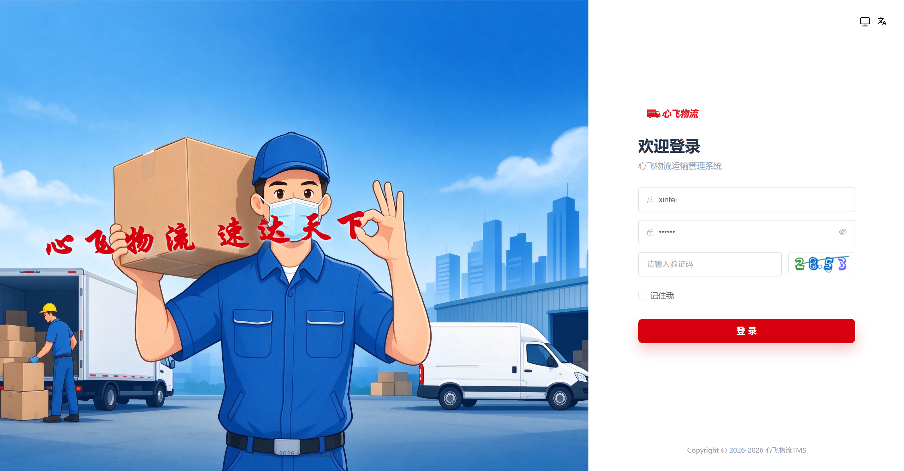
  <br/><sub><b>Admin Login</b> · unified account + captcha</sub>
</td>
<td align="center" width="50%">
  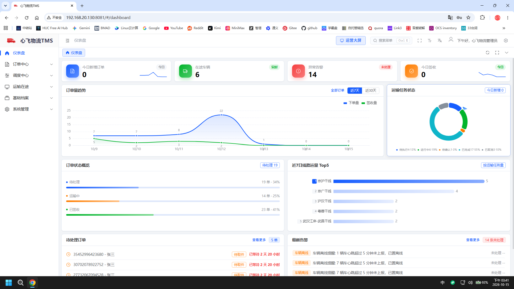
  <br/><sub><b>Dashboard</b> · orders / alarms / todos &amp; charts</sub>
</td>
</tr>
</table>

### 2.5 Feature Progress Matrix

|  |  |  |  |
| --- | --- | --- | --- |
| ✅ Order Management | ✅ Intelligent Dispatch | ✅ Operations | ✅ Tracking |
| ✅ Multi-Tenant Auth | ✅ Master Data | ✅ Waybill | ✅ Reports |
| ✅ 4-End Apps | ✅ Permission / Menu | ✅ Vehicle / Route | ✅ Personnel |
| 🔲 Settlement | 🔲 OR-Tools Route Planning | 🔲 POD OCR | 🔲 Dynamic ETA |
| 🔲 AI Assistant (Spring AI) | 🔲 ES Search | 🔲 MinIO Object Storage | 🔲 Kafka Pipeline |

---

<a id="sec-pain"></a>

## 3. 🎯 Pain Points We Solve

| Industry pain point | How Pinda TMS solves it |
| --- | --- |
| Vehicles / drivers / routes scattered, hard to evaluate | Centralized master data + multi-dimensional reports |
| Manual dispatch, experience-based load planning | Scheduled dispatch + route planning auto-generating transport tasks &amp; trips |
| Opaque in-transit process | GPS vehicle tracking + track replay, real-time status query |
| Opaque freight calculation, error-prone | Drools dynamic rule engine — configurable &amp; auditable billing rules |
| Customers have no way to track, no POD evidence | Customer app tracking + electronic POD / receipt evidence |
| Data silos, manual statistics | Data aggregation + real-time analysis, automatic business reports |

---

<a id="sec-ends"></a>

## 4. 📱 Four-End Synergy

| End | Name | Users | Core capabilities |
| --- | --- | --- | --- |
| Admin Console | Pinda TMS Admin | Internal admins | Master data, order management, waybill management |
| Customer App | **Pinda Express** | External customers | Booking, shipment tracking |
| Courier App | **Pinda Courier** | Internal couriers | Pickup &amp; delivery tasks |
| Driver App | **Pinda Driver** | Internal drivers | Transport tasks, location reporting |

---

<a id="sec-features"></a>

## 5. 🔍 Feature Overview

### 5.1 End-to-End Business Flow

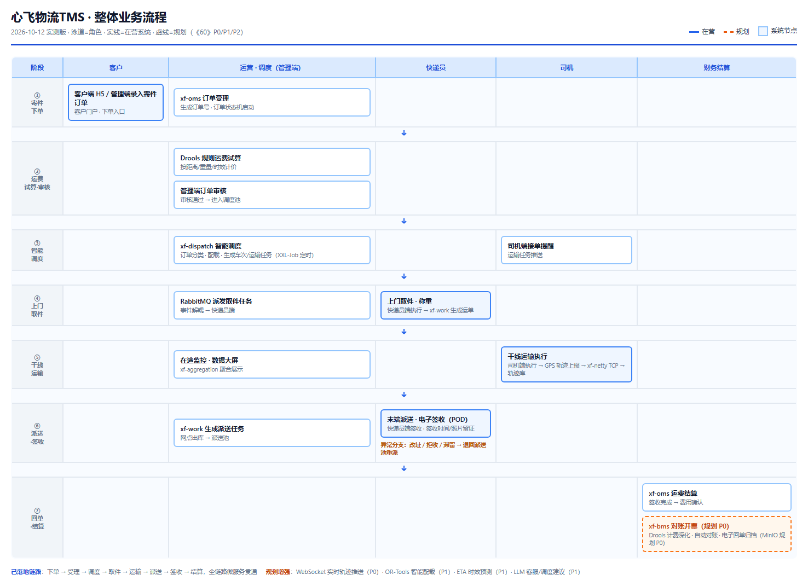

```
Booking 📦 → Order creation 📋 → Intelligent dispatch 🤖 (Drools) → Driver accepts 🚚
→ Operations ⚙️ → Tracking 📍 (Netty) → POD ✅ → Settlement 💰
```

### 5.2 Core Modules

| Module | Description |
| --- | --- |
| **Order Management** | Booking, cargo management, full lifecycle status, freight estimation |
| **Intelligent Dispatch** | Order classification, route planning, transport task creation, trip/vehicle/driver assignment |
| **Transport Management** | Task execution, driver job sheets, in-transit status tracking |
| **GPS Tracking / Monitoring** | Real-time vehicle location, track replay, deviation &amp; anomaly alerts |
| **Delivery Execution** | Pickup/delivery tasks, waybill management, electronic POD |
| **Resource Management** | Fleet, vehicle, vehicle type, line, trip maintenance |
| **Personnel Management** | Driver, courier, position &amp; organization management |
| **Customer Portal** | Customer app: booking, tracking, logistics timeline |
| **POD &amp; Settlement** | POD evidence, cost settlement, reconciliation |
| **Data Reports** | Volume, service level, cost, performance statistics |
| **Master Data** | Organization, menu, permission, dictionary |
| **Unified Auth &amp; Permission** | Sa-Token based user / role / menu / multi-tenant auth |

---

<a id="sec-tech"></a>

## 6. 🏗 Technical Solution

### 6.0 Project Structure

```
pinda-tms/
├── Microservices (13)
│   ├── pd-gateway/           # Unified gateway (Spring Cloud Gateway)
│   ├── pd-auth/              # Auth center (Sa-Token + multi-tenant)
│   ├── pd-base/              # Master data (org / vehicle / line / cargo)
│   ├── pd-oms/               # Order management (OMS)
│   ├── pd-dispatch/          # Intelligent dispatch (Drools + XXL-Job)
│   ├── pd-work/              # Operations (pickup/delivery & transport tasks)
│   ├── pd-user/              # Users & members
│   ├── pd-netty/             # Tracking ingestion (Netty TCP)
│   ├── pd-aggregation/       # Data aggregation
│   └── pd-web/               # BFF layer (4-end APIs)
│       ├── pd-web-manager/   #   Admin BFF
│       ├── pd-web-courier/   #   Courier BFF
│       ├── pd-web-customer/  #   Customer BFF
│       └── pd-web-driver/    #   Driver BFF
├── Support libs (2 jars)
│   ├── pd-common/            # Common components (utils / context / interceptors)
│   └── pd-service-api/       # Inter-service API contracts (Feign)
├── Frontend (4 ends)
│   ├── pd-admin-ui-vue3/     # Admin (Vue3 + Element Plus)
│   └── pd-mobile/            # Mobile 3 ends (uni-app Vue3)
│       ├── customer/         #   Customer · Pinda Express
│       ├── courier/          #   Courier · Pinda Courier
│       └── driver/           #   Driver · Pinda Driver
├── deploy/                   # Docker Compose orchestration & deployment scripts
└── docs/                     # Docs + screenshots + badges
```

### 6.1 System Architecture

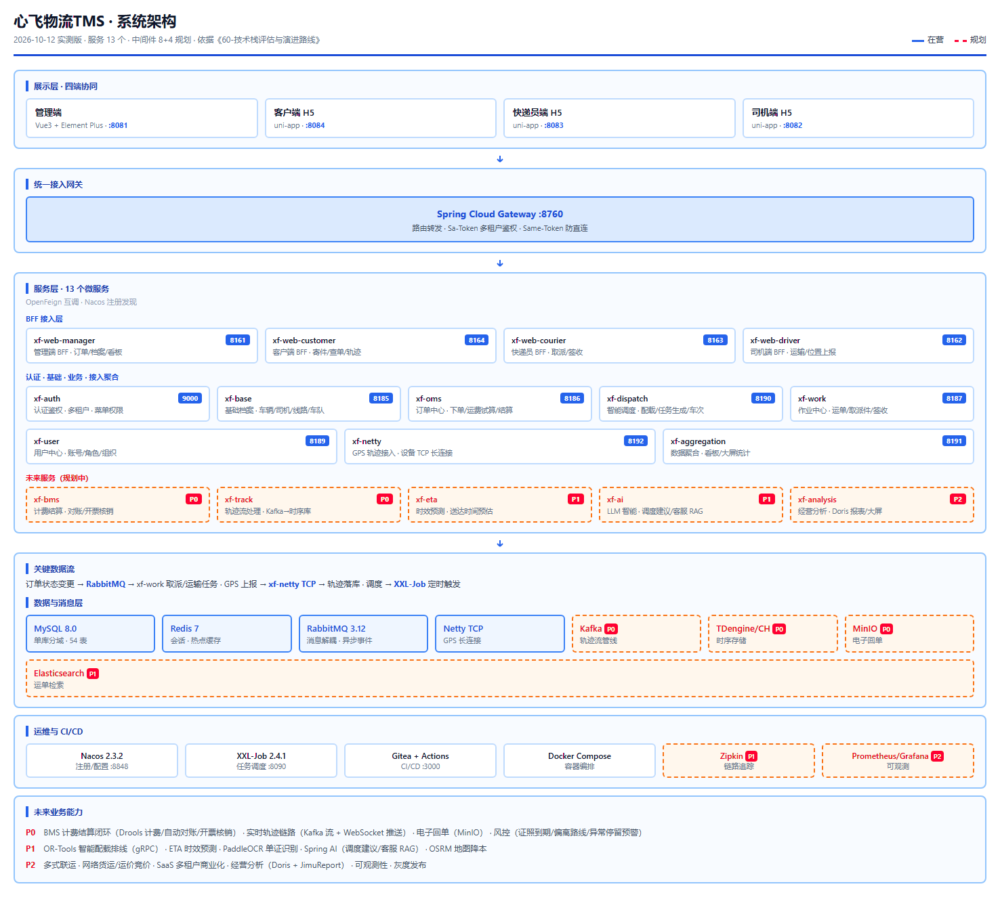

> Four layers: **Presentation** (Admin Vue3 + mobile uni-app) → **Gateway** (Spring Cloud Gateway, Sa-Token auth + Same-Token anti-direct-access) → **Service** (13 business microservices, Nacos registry/config) → **Data** (MySQL single-db-by-domain + Redis + RabbitMQ).

### 6.2 Microservice Architecture

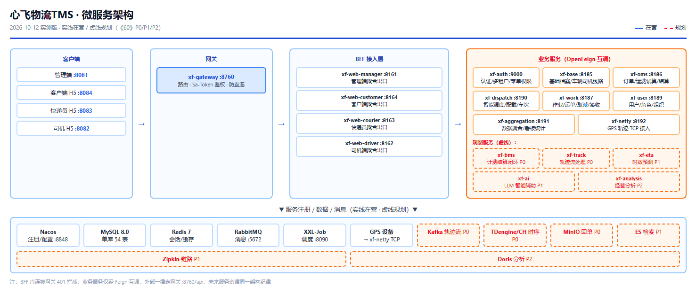

> Microservices split by business domain: `pd-auth`, `pd-gateway`, `pd-base`, `pd-oms`, `pd-dispatch`, `pd-work`, `pd-netty`, `pd-aggregation`, etc., communicating via OpenFeign, registered &amp; discovered via Nacos.

### 6.3 Technology Architecture

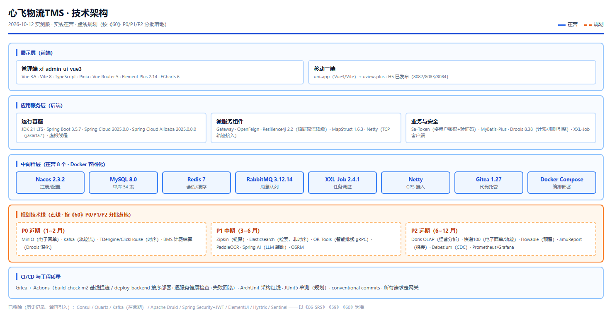

> Backend JDK 21 + Spring Boot 3.5.7 + Spring Cloud 2025.0.0 + MyBatis-Plus + Drools + XXL-Job; Frontend Vue 3 + Vite + Element Plus + Pinia + ECharts; Mobile uni-app Vue3 + uview-plus; Middleware MySQL 8 + Redis 7 + RabbitMQ + Nacos + Docker Compose.

### 6.4 Tech Highlights

#### 6.4.1 Landed

| Technology | Role in the system |
| --- | --- |
| **JDK 21 Virtual Threads** | Higher throughput on IO-heavy scenarios, lower thread overhead |
| **Drools 8.38 rule engine** | Configurable, hot-reloadable freight &amp; business rules |
| **XXL-Job 2.4.1 distributed scheduling** | Unified orchestration of dispatch &amp; periodic tasks (replaces Quartz) |
| **Sa-Token + JWT multi-tenant auth** | Unified login, stateless auth, multi-tenant &amp; captcha |
| **Spring Cloud Gateway** | Routing, login-state validation &amp; anti-direct-access |
| **Netty** | High-concurrency TCP channel for tracking reporting &amp; device access |
| **Baidu Map** | Address resolution, distance calculation, track display |
| **Druid connection pool** | Connection management &amp; SQL monitoring |

#### 6.4.2 Why These Choices

| Choice | Why not the alternative? |
| --- | --- |
| **Sa-Token** over Shiro | Lighter, native multi-tenancy, complete Chinese docs, no Boot 3 compatibility baggage |
| **XXL-Job** over Quartz | Distributed scheduling with built-in admin console; Quartz means building your own scheduler |
| **Drools** over if-else | Rules are visible, hot-reloadable, no redeploy needed |
| **Single-db-by-domain** over 8 databases | Lower dev/small-scale ops cost; evolve to time-series DB at scale |
| **Resilience4j** over Hystrix | Hystrix is archived; R4 is the Spring Cloud official direction (planned) |

#### 6.4.3 Code Snippets

**Drools dispatch rule** (`pd-dispatch`) — rules are configuration, hot-reloaded without redeploy:

```java
rule "same-city order priority"
when
    $order : Order(distanceType == "LOCAL", priority >= 5)
    $driver : Driver(status == "IDLE", city == $order.pickupCity)
then
    $order.assignTo($driver);
end
```

**Netty tracking ingestion** (`pd-netty`) — self-built TCP channel, no third-party SDK:

```java
@ChannelHandler.Sharable
public class LocationServerHandler extends SimpleChannelInboundHandler<ByteBuf> {
    @Override
    protected void channelRead0(ChannelHandlerContext ctx, ByteBuf in) {
        // parse location protocol → store track → push to dispatch / monitoring
    }
}
```

#### 6.4.4 Evolution Roadmap (Planned)

Reviewed and approved items, not yet landed; batched by priority (see the refactoring plan &amp; doc 《53》R2):

| Technology | Purpose | Priority |
| --- | --- | --- |
| **MinIO object storage** | POD &amp; signature photos (S3 protocol) | P1 near-term |
| **Zipkin tracing** | Micrometer Tracing + Zipkin call-chain monitoring | P1 near-term |
| **Resilience4j** | Circuit breaker, fallback &amp; rate limiting | P1 near-term |
| **MapStruct** | Compile-time type-safe mapping instead of reflection copy | P1 near-term |
| **Kafka** | Track pipeline (Netty → Kafka → time-series store) | P2 mid-term |
| **Debezium CDC** | binlog change capture, MySQL → Kafka → ES / Doris sync | P2 mid-term |
| **Elasticsearch** | Waybill multi-condition &amp; fuzzy search | P2 mid-term |
| **Google OR-Tools** | VRP optimization (CVRP / VRPTW) for dispatch | P2 mid-term |
| **Apache Doris OLAP** | Reports &amp; analytics, MySQL-protocol compatible | P2 mid-term |
| **Baidu Yingyan** | Track correction &amp; geofencing | P2 mid-term |
| **Spring AI 2.0** | LLM chat / RAG / agent orchestration for smart customer service | P3 long-term |
| **Kuaidi100** | Multi-carrier tracking, e-waybill printing, booking | P3 long-term |
| **Flowable workflow** | Approval flows: exception handling, re-dispatch, reconciliation | P3 long-term |
| **JimuReport** | Visual reports &amp; big-screen dashboards | P3 long-term |

### 6.5 Database Design

After the full refactor the system converges to a **single MySQL database** (`pinda_tms`), table-prefixed by business domain, splittable per domain at scale:

| Domain | Main tables |
| --- | --- |
| Master data | cargo types, vehicles, fleets, lines, organizations, stations |
| Order (OMS) | orders, cargo info, order locations |
| Operations | pickup/delivery tasks, transport tasks, driver job sheets, waybills |
| Dispatch | order classification, route caches |
| Auth &amp; permission | tenants, users, roles, menus, resources |
| Tracking &amp; location | vehicle tracks &amp; locations (time-series DB planned at scale, see §6.4) |

---

<a id="sec-quickstart"></a>

## 7. 🚀 Quick Start

### 7.1 Environment &amp; Stack

- **Backend**: JDK 21 + Spring Boot 3.5.7 + Spring Cloud 2025.0.0 (Spring Cloud Alibaba 2025.0.0.0), Nacos registry/config, OpenFeign, Spring Cloud Gateway auth, Sa-Token multi-tenant auth, XXL-Job, Drools.
- **Frontend**: Admin `pd-admin-ui-vue3` (Vue 3 + Vite + Element Plus + Pinia + ECharts); Mobile uni-app (Vue 3 / Vite + uview-plus) for 3 apps.
- **Storage &amp; middleware**: MySQL (single-db-by-domain), Redis cache, RabbitMQ, Druid; MinIO &amp; ES are planned (see §6.4).
- **Support**: unified auth center (Sa-Token multi-tenant + captcha), gateway anti-direct-access, Netty tracking ingestion.

### 7.2 Run in Five Minutes

```bash
git clone https://gitee.com/itxinfei/pinda-tms.git
cd pinda-tms
docker-compose up -d        # start middleware: MySQL / Redis / RabbitMQ / Nacos
# ① run docs/sql init scripts (pinda_tms single DB + seed data)
# ② start pd-auth → pd-gateway → business microservices (mvn spring-boot:run or deploy scripts)
# ③ start admin (pnpm i && pnpm dev) and mobile (run uni-app in HBuilderX)
```

> Expected 5–10 minutes. Detailed deployment, config &amp; secondary-development docs: see 「9. Documents」; a pre-built VM image (middleware pre-installed) is available from the author — see 「10. Pre-built VM Image」.

---

<a id="sec-screens"></a>

## 8. 📸 Screenshots

> Screenshots are from a real running environment (updated 2026-10-12). Admin core business pages and the 3 mobile apps are all captured.

### 8.1 Admin Console

<table>
<tr>
<td align="center" width="50%">
  
  <br/><sub><b>Admin Login</b> · unified account + captcha</sub>
</td>
<td align="center" width="50%">
  
  <br/><sub><b>Dashboard</b> · orders / alarms / todos &amp; charts</sub>
</td>
</tr>
<tr>
<td align="center" width="50%">
  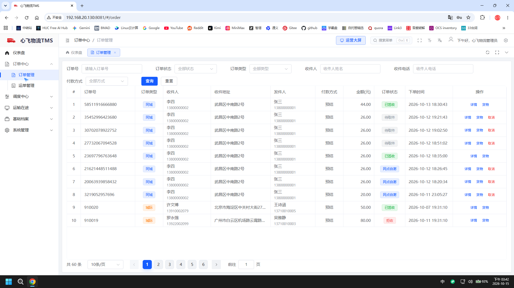
  <br/><sub><b>Order Management</b> · status filter / paginated list (real data)</sub>
</td>
<td align="center" width="50%">
  <div style="border:2px dashed #d0d7de;border-radius:8px;padding:52px 12px;color:#8b949e;background:#fafbfc;">
    📷 To be added<br/><sub>Dispatch / waybill pages<br/>(replace with screenshots after running)</sub>
  </div>
</td>
</tr>
</table>

### 8.2 Mobile Apps

<table>
<tr>
<td align="center" width="33%"><b>Customer · Pinda Express</b><br/><br/>
  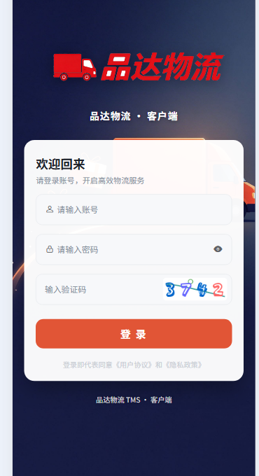
  <br/><sub>Booking / tracking · H5 (:8084)</sub>
</td>
<td align="center" width="33%"><b>Courier · Pinda Courier</b><br/><br/>
  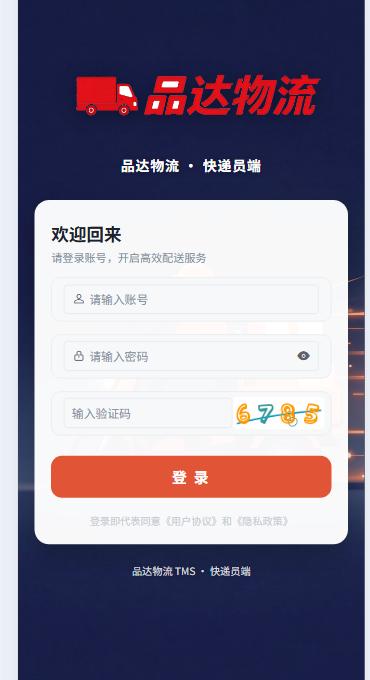
  <br/><sub>Pickup/delivery tasks · H5 (:8083)</sub>
</td>
<td align="center" width="33%"><b>Driver · Pinda Driver</b><br/><br/>
  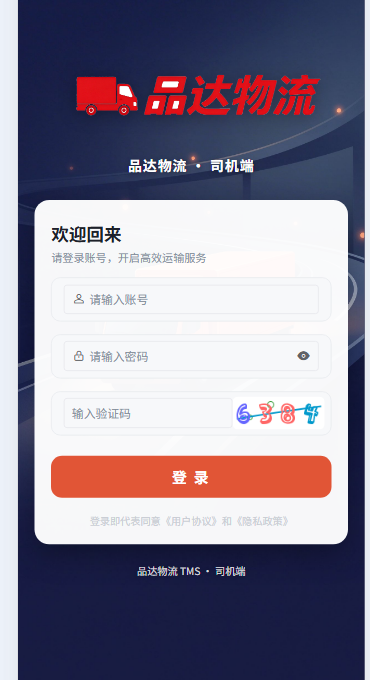
  <br/><sub>Transport tasks / location · H5 (:8082)</sub>
</td>
</tr>
</table>

### 8.3 Ops &amp; Middleware

<table>
<tr>
<td align="center" width="50%">
  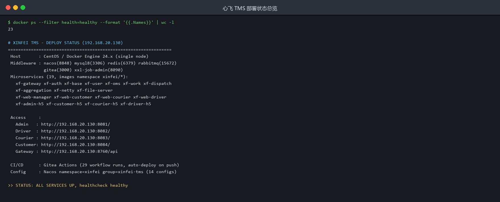
  <br/><sub><b>Deploy Status</b> · all microservices health monitoring</sub>
</td>
<td align="center" width="50%">
  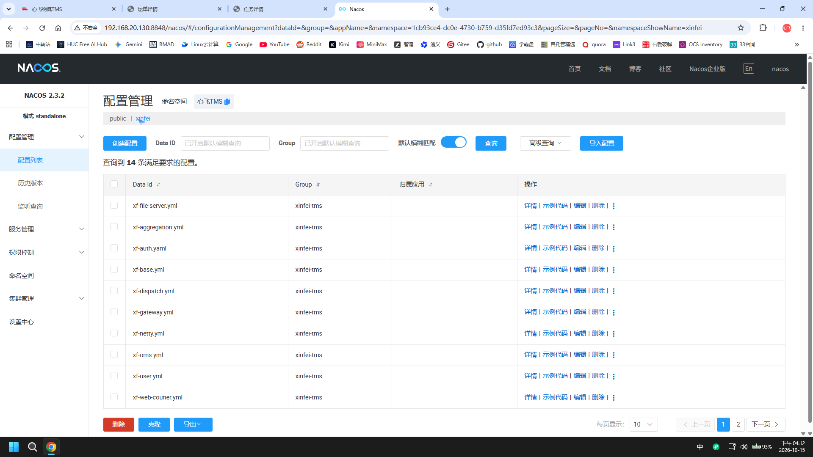
  <br/><sub><b>Nacos</b> · registry / config center</sub>
</td>
</tr>
<tr>
<td align="center" width="50%">
  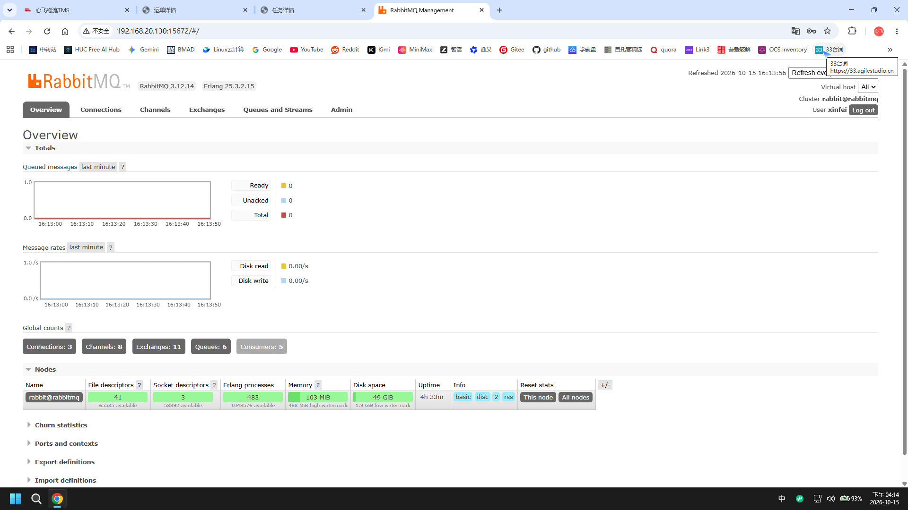
  <br/><sub><b>RabbitMQ</b> · message queue monitoring</sub>
</td>
<td align="center" width="50%">
  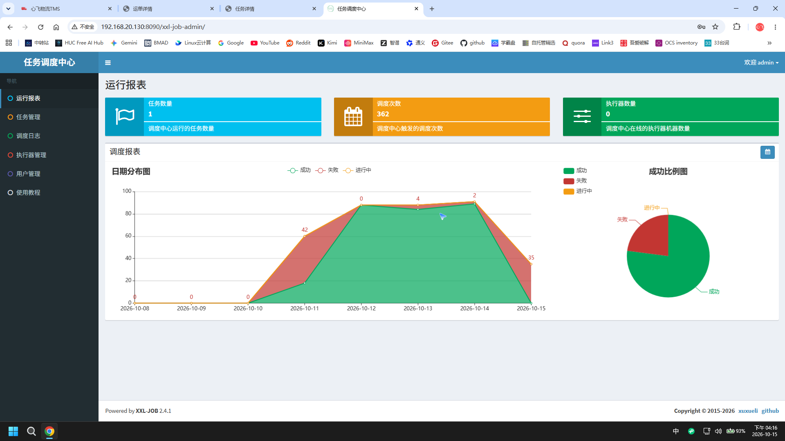
  <br/><sub><b>XXL-Job</b> · scheduled tasks &amp; reports</sub>
</td>
</tr>
<tr>
<td align="center" width="50%">
  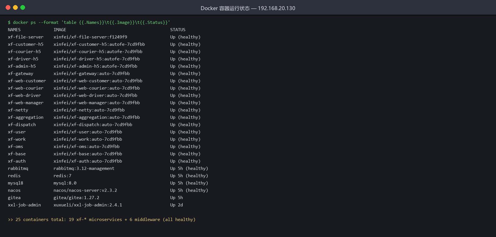
  <br/><sub><b>Docker</b> · microservice &amp; middleware container health</sub>
</td>
<td align="center" width="50%">
  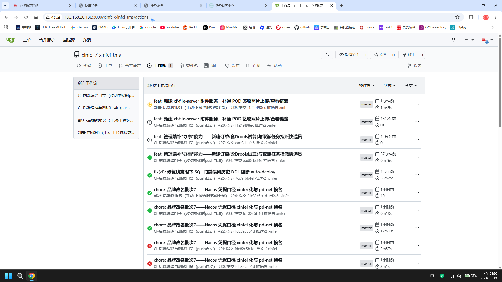
  <br/><sub><b>Gitea CI/CD</b> · ordered backend deployment + per-service health checks</sub>
</td>
</tr>
<tr>
<td align="center" width="50%">
  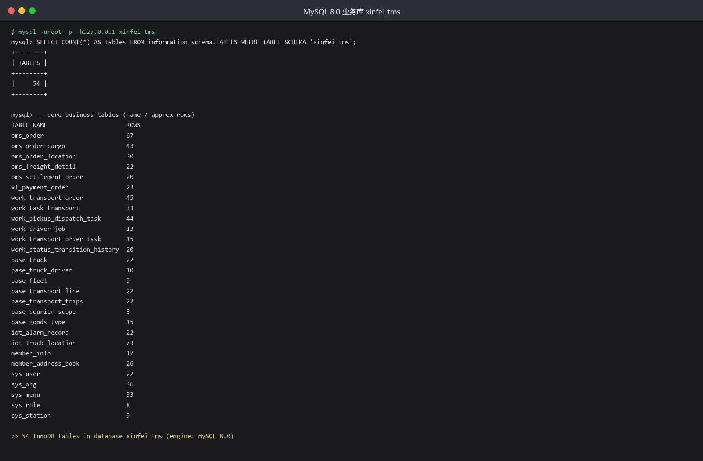
  <br/><sub><b>MySQL 8.0</b> · direct query · pinda_tms all 54 tables (InnoDB)</sub>
</td>
<td align="center" width="50%">
  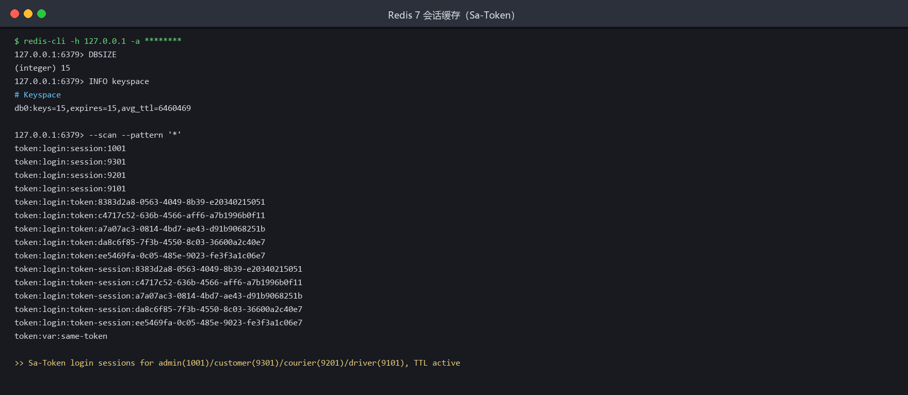
  <br/><sub><b>Redis 7</b> · Sa-Token session cache &amp; TTL</sub>
</td>
</tr>
</table>

---

<a id="sec-docs"></a>

## 9. 📚 Documents

All documents below are local files in the repo. **`docs/` and `docs/需求文档/` are two independent numbering systems**.

**① Root docs** (`docs/`, deployment / architecture / stack / environment):

| Document | Description |
| --- | --- |
| [docs/01-技术栈说明.md](docs/01-技术栈说明.md) | Technology stack overview &amp; verification |
| [docs/02-架构设计.md](docs/02-架构设计.md) | System architecture, services, call graph, deployment topology |
| [docs/03-功能规划与需求说明.md](docs/03-功能规划与需求说明.md) | Feature list &amp; requirements |
| [docs/04-部署与二次开发指南.md](docs/04-部署与二次开发指南.md) | Deployment, initialization &amp; secondary development guide |
| [docs/05-部署文档.md](docs/05-部署文档.md) | Middleware deployment manual |
| [docs/06-品达TMS-开发测试环境手册.md](docs/06-品达TMS-开发测试环境手册.md) | Dev / test environment guide |

**② Requirements docs** (`docs/需求文档/`, independent numbering, authoritative entry: 00-索引):

| Document | Description |
| --- | --- |
| [docs/需求文档/00-索引.md](docs/需求文档/00-索引.md) | Requirements index |
| [docs/需求文档/01-业务需求全景.md](docs/需求文档/01-业务需求全景.md) | Business requirements overview |

**Design diagrams** (in `docs/`): `system-arch.png` (system), `microservice-arch.png` (microservices), `tech-arch.png` (technology), `business-flow.png` (business flow).

---

<a id="sec-vm"></a>

## 10. 📦 Pre-built VM Image

> This project's learning &amp; deployment rely on a **pre-built VM image** — middleware, database and base environment are pre-installed, saving you the setup effort.
> The image is distributed via **Baidu Netdisk**; the link is **not public** — contact the author for the latest address.

---

<a id="sec-contact"></a>

## 11. 🤝 Business Services &amp; Contact

<div align="center">

<table>
<tr>
<td align="center" width="50%">

### 11.1 🛠️ Paid Technical Services

This project is **fully open source &amp; free under Apache-2.0**. The author also offers commercial support:

- 🔧 **Secondary development / customization** (platform integration, new features, UI adjustments)
- 🚀 **Private deployment delivery** (server, domain, environment, incl. VM image)
- 🎓 **Project walkthrough / thesis Q&amp;A** (architecture, source code, interview topics)
- 📦 **Full database init scripts + demo data**
- 💬 Daily technical Q&amp;A &amp; long-term maintenance support

<b>👉 Business contact QQ: <code>747011882</code></b>

</td>
<td align="center" width="50%">

### 11.2 💬 Join the Community


<sub>Scan to follow WeChat official account 「心飞为你飞」</sub>

<br>

🔗 Repo: [gitee.com/itxinfei/pinda-tms](https://gitee.com/itxinfei/pinda-tms)
🏠 Author: [gitee.com/itxinfei](https://gitee.com/itxinfei)

</td>
</tr>
</table>

<br>

### 11.3 ⭐ If this project helps you, please give it a Star — it means a lot to me!

</div>

### 11.4 ☕ Sponsorship

> This project is **developed with AI assistance**, and continuous iteration requires significant time and AI tool costs. If Pinda TMS helps you, please consider sponsoring the author to keep it updated.

> 📌 **Sponsorship contact**: add **QQ: `747011882`** to discuss (sponsor list will be updated in this README); WeChat / Alipay QR-code entry coming soon.

---

<a id="sec-milestones"></a>

## 12. 🗓️ Milestones

| Time | Progress |
| --- | --- |
| 2026-09 | ✅ Project kickoff: 4-end skeleton + 13 microservices + full business closed loop |
| 2026-10 | ✅ Stack modernization: JDK 21 + SB 3.5.7 + Vue3 + Sa-Token multi-tenant + XXL-Job |
| 2026-Q4 | 🔲 Tracking pipeline: Kafka + TDengine / Yingyan + ES waybill search |
| 2027-H1 | 🔲 OR-Tools route planning + MinIO POD + Doris reports |
| 2027-H2 | 🔲 Spring AI assistant + POD OCR + dynamic ETA |

---

<a id="sec-faq"></a>

## 13. ❓ FAQ

**Q: Can I use it commercially?**
A: Apache-2.0 license — free for commercial use, no strings attached.

**Q: Why such a modern stack (JDK 21 + Spring Boot 3.5)?**
A: A new project in 2026 carries no legacy baggage; we adopt the latest LTS to avoid forced upgrades later.

**Q: Is there documentation?**
A: Yes — see 「9. Documents」: architecture / stack / features / deployment / dev-environment guides.

**Q: Does the mobile side support mini-programs?**
A: uni-app 3-end architecture (App / H5 / Mini-Program); currently H5-first. A real appid is required before publishing mini-programs.

---

<a id="sec-contrib"></a>

## 14. 🤝 Contributing

<div align="center">


</div>

Pull Requests are welcome! Please follow these conventions:

- **Code style**: backend follows 《Alibaba Java Development Manual》; frontend follows ESLint + Prettier + Stylelint
- **Commit format**: `type(scope): description` (e.g. `feat(oms): add split-order API` / `fix(dispatch): fix NPE in route planning`)
- **No over-engineering**: build only what is directly needed; no speculative features
- **No hard-coding**: cron / thresholds / map keys / status numbers must be externalized as config
- **All requests go through the gateway**: `http://<host>:8760/api` + end prefix; direct microservice access is forbidden

> Discuss the direction in an Issue before submitting a PR.

---

<p align="center"><sub>Open-source TMS · Transportation Management System · Logistics · Fleet Management · Dispatch · Tracking · Spring Cloud Microservices · JDK 21 · Vue 3 · uni-app</sub></p>

<p align="center"><sub>Pinda Logistics TMS · Open-Source Transportation Management System · Full Process · 4-End Synergy · Microservices</sub></p>
