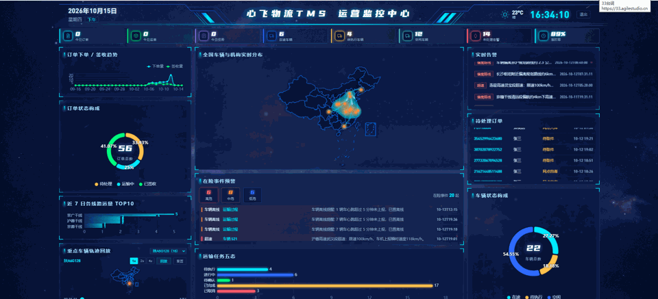

<div align="center">

<p align="center"></p>

<p>  
  <b>面向运输企业与承运商的开源运输管理系统（TMS）</b>  

  全流程闭环 · 四端协同 · 微服务架构 · 开箱即用  
</p>

<p>  
    
    
    
    
    
    
    
    
    
    
    
    
    
    
    
    
    
    
    
    
    
    
    
    
    
    
    
    
</p>  
</div>

<p align="center"><b>简体中文</b> · <a href="README.en.md">English</a></p>

> **心飞 TMS** 是一款**四端协同**（管理端 + 客户端 + 快递员端 + 司机端）的开源运输管理系统，基于 **JDK 21 + Spring Boot 3.5.7 + Vue 3.5** 构建，覆盖寄件 → 订单 → 智能调度 → 作业 → 轨迹 → 回单全链路。Drools 规则引擎驱动智能调度，Netty 自建轨迹接入，Sa-Token 多租户 SaaS 就绪。

<p align="center">  
<b><a href="#sec-tech"><code>14</code></a></b> 个微服务 · <b><code>4</code></b> 端协同 · <b><code>106</code></b> 条功能需求 · <b><code>55</code></b> 张数据表 · <b><code>27</code></b> 项技术栈 · 全链路业务闭环  
</p>
<p align="center">  
🔗 <b>项目资料</b>：<a href="https://itxinfei.github.io/xinfei-tms/" target="_blank">https://itxinfei.github.io/xinfei-tms/</a> 
</p>


---

## 📑 目录

- [一、项目是什么 · 解决什么问题](#sec-intro)
- [二、核心优势](#sec-advantages)
- [三、解决的核心痛点](#sec-pain)
- [四、四端协同](#sec-ends)
- [五、功能全景](#sec-features)
- [六、技术方案](#sec-tech)
- [七、快速了解](#sec-quickstart)
- [八、系统截图](#sec-screens)
- [九、相关资料](#sec-docs)
- [十、配套虚拟机（环境镜像）](#sec-vm)
- [十一、商业服务与联系](#sec-contact)
- [十二、里程碑](#sec-milestones)
- [十三、常见问题（FAQ）](#sec-faq)
- [十四、参与贡献](#sec-contrib)

---

<a id="sec-intro"></a>

## 一、项目是什么 · 解决什么问题

物流运输市场最普遍的四种业态是 **快递、快运、专线、三方**，它们支撑着全国商品货物的流通。无论是哪一类企业，核心痛点都高度一致：**车辆、驾驶员、线路散落难管，运输过程不透明，调度与计费靠人工，成本与时效无从考核**。

心飞物流 TMS 正是为解决这些问题而生——它把「运力资源准备 → 下单 → 调度 → 运输 → 派送 → 签收 → 结算」的全链路搬进一套系统，对车辆、驾驶员、线路进行全面详尽的统计与考核，帮助企业**提高运作效率、降低运输成本，在激烈的市场竞争中处于领先地位**。

> 💡 **为什么做这个项目？** 市面上的 TMS 要么**太贵**（商业年费 3-30 万），要么**太旧**（JDK 8 + Vue 2 停留在上个时代），要么**太重**（实施周期 6 个月起步）。心飞 TMS 想做**第三个选择**：源码公开（个人学习研究免费）、全链路闭环、技术前沿、四端协同——开箱即用，二次开发友好。

---

<a id="sec-advantages"></a>

## 二、✨ 核心优势

### 2.1 谁适合用心飞？

- 🚛 **中小微车队**（10-50 辆）：想数字化，但买不起年费 3-30 万的商业 TMS
- 🚀 **物流初创团队**：需要一个功能全、栈新、能跑的四端 TMS 做 MVP
- 📚 **Java 学习者**：一套代码学微服务 + 规则引擎 + Netty + 多租户实战
- 🔧 **二次开发商**：给客户做定制交付，省 3 个月底子工程

### 2.2 与同类方案对比

| 能力                       | 心飞 TMS            | 同类开源 TMS      | 商业 TMS     |
| ------------------------ | ----------------- | ------------- | ---------- |
| 四端协同（管理+客户+快递员+司机）       | ✅                 | ❌ 仅管理端        | ✅          |
| JDK 21 + Spring Boot 3.5 | ✅                 | ❌ 多为 JDK 8    | 部分已升级      |
| 多租户 SaaS                 | ✅                 | ❌             | ✅          |
| 智能调度（Drools 规则引擎）        | ✅                 | ❌ if-else 硬编码 | ✅          |
| Netty 自建轨迹接入             | ✅                 | ❌             | ✅          |
| 年费                       | **0（BUSL-1.1，学习/研究免费）** | 0             | **3-30 万** |
| 二开自由                     | ✅ 代码全开源           | ✅             | ❌ 黑盒交付     |

> 「同类开源」泛指 Gitee/GitHub 上主流开源 TMS 项目，不针对特定项目；如有不准确欢迎 Issue 纠正。

### 2.3 眼见为实

<table>  
<tr>  
<td align="center" width="50%">  
    
     <sub><b>管理端登录</b> · 统一账号 + 验证码校验</sub>  
</td>  
<td align="center" width="50%">  
    
     <sub><b>工作台仪表盘</b> · 订单 / 告警 / 待办与图表统计</sub>  
</td>  
</tr>  
</table>

> 🎬 **运营监控中心大屏 · 实时动态演示**（真实运行环境录制）：



### 2.4 功能进度矩阵

|                     |                   |                |                |
| ------------------- | ----------------- | -------------- | -------------- |
| ✅ 订单管理              | ✅ 智能调度            | ✅ 作业管理         | ✅ 轨迹追踪         |
| ✅ 多租户认证             | ✅ 基础数据            | ✅ 运单管理         | ✅ 数据报表         |
| ✅ 四端 App            | ✅ 权限 / 菜单         | ✅ 车辆 / 线路      | ✅ 人员管理         |
| 🔲 财务结算             | 🔲 智能排线（OR-Tools） | 🔲 回单 OCR      | 🔲 动态 ETA      |
| 🔲 AI 客服（Spring AI） | 🔲 ES 检索          | 🔲 对象存储（MinIO） | 🔲 消息管线（Kafka） |

---

<a id="sec-pain"></a>

## 三、🎯 解决的核心痛点

| 行业痛点                   | 心飞 TMS 的解法                |
| ---------------------- | ------------------------- |
| 车辆 / 驾驶员 / 线路分散，难以统一考核 | 基础数据集中管理 + 多维统计报表，人车线一目了然 |
| 调度靠人工、配载凭经验            | 定时调度 + 路径规划自动生成运输任务与车次分配  |
| 运输过程黑盒，在途不可见           | GPS 车辆定位 + 轨迹回放，在途状态实时可查  |
| 运费计算不透明、易出错            | Drools 动态规则引擎，计费规则可配置、可追溯 |
| 客户查件无渠道、签收无留证          | 客户端 App 查物流 + 电子签收 / 回单留证 |
| 数据孤岛、统计靠手工             | 数据聚合 + 实时分析，经营报表自动产出      |

---

<a id="sec-ends"></a>

## 四、📱 四端协同

| 端        | 名称         | 使用对象    | 核心能力             |
| -------- | ---------- | ------- | ---------------- |
| 后台系统管理端  | 心飞 TMS 管理端 | 公司内部管理员 | 基础数据维护、订单管理、运单管理 |
| 客户端 App  | **心飞速运**   | 外部客户    | 寄件、查询物流信息        |
| 快递员端 App | **心飞快递员**  | 公司内部快递员 | 接收取派件任务          |
| 司机端 App  | **心飞司机宝**  | 公司内部司机  | 接收运输任务、上报位置信息    |

---

<a id="sec-features"></a>

## 五、🔍 功能全景

### 5.1 整体业务流程


```
寄件下单 📦 → 订单创建 📋 → 智能调度 🤖（Drools）→ 司机接单 🚚
→ 作业执行 ⚙️ → 轨迹追踪 📍（Netty）→ 回单签收 ✅ → 对账结算 💰
```

### 5.2 核心业务模块

| 模块                  | 功能描述                             |
| ------------------- | -------------------------------- |
| **订单管理**            | 寄件下单、货物管理、订单全生命周期状态管理、运费试算       |
| **智能调度**            | 订单分类、路径规划、运输任务创建、车次 / 车辆 / 司机分配  |
| **运输管理（行车管理）**      | 运输任务执行、司机作业单、在途状态跟踪              |
| **GPS 车辆定位 / 在途监控** | 车辆实时定位、轨迹回放、偏航与异常监控              |
| **配送执行**            | 取派件任务、运单管理、电子签收（POD）             |
| **车辆 / 线路 / 车次管理**  | 车队、车辆、车型、线路、车次等运输资源维护            |
| **人员管理**            | 司机、快递员、岗位与组织管理                   |
| **客户门户**            | 客户端 App 寄件、查单、物流跟踪               |
| **回单与结算**           | 回单签收留证、费用结算、对账                   |
| **数据报表**            | 运输量、时效、成本、绩效等多维统计                |
| **基础信息维护**          | 组织机构、菜单、权限、字典等支撑数据               |
| **统一认证与权限**         | 基于开源 Sa-Token 的用户、角色、菜单、多租户认证与鉴权 |

### 5.3 订单状态机（示例）

订单生命周期由一套多级状态机驱动，典型流转如下：

```
待取件 → 已取件 → 待装车 → 运输中 → 网点出库 → 待派送 → 派送中 → 已签收
                                                  └→ 拒收 / 已取消
```

---

<a id="sec-tech"></a>

## 六、🏗 技术方案

### 6.0 项目结构

```
xinfei-tms/
├── 微服务（14 个）
│   ├── xf-gateway/           # 统一网关（Spring Cloud Gateway）
│   ├── xf-auth/              # 认证中心（Sa-Token + 多租户）
│   ├── xf-base/              # 基础数据（机构 / 车辆 / 线路 / 货物）
│   ├── xf-oms/               # 订单管理（OMS）
│   ├── xf-dispatch/          # 智能调度（Drools + XXL-Job）
│   ├── xf-work/              # 作业管理（取派件 / 运输任务）
│   ├── xf-user/              # 用户与会员
│   ├── xf-file-server/       # 附件服务（POD 照片上传/查看，无数据库）
│   ├── xf-netty/             # 轨迹接入（Netty TCP）
│   ├── xf-aggregation/       # 数据聚合
│   └── xf-web/               # BFF 聚合层（四端接口）
│       ├── xf-web-manager/   #   管理端 BFF
│       ├── xf-web-courier/   #   快递员端 BFF
│       ├── xf-web-customer/  #   客户端 BFF
│       └── xf-web-driver/    #   司机端 BFF
├── 支撑库（2 个 jar）
│   ├── xf-common/            # 公共组件（工具 / 上下文 / 拦截器）
│   └── xf-service-api/       # 服务间 API 契约（Feign 接口）
├── 前端（4 端）
│   ├── xf-admin-ui-vue3/     # 管理端（Vue3 + Element Plus）
│   └── xf-mobile/            # 移动三端（uni-app Vue3）
│       ├── customer/         #   客户端 · 心飞速运
│       ├── courier/          #   快递员端 · 心飞快递员
│       └── driver/           #   司机端 · 心飞司机宝
├── deploy/                   # Docker Compose 编排与部署脚本
└── docs/                     # 文档 + 截图 + 徽章
```

### 6.1 系统架构


> 系统分四层：**展示层**（管理端 Vue3 + 移动三端 uni-app）→ **网关层**（Spring Cloud Gateway，Sa-Token 鉴权 + Same-Token 防直连）→ **服务层**（14 个业务微服务，Nacos 注册/配置中心）→ **数据层**（MySQL 单库分域 + Redis + RabbitMQ）。

### 6.2 微服务架构


> 微服务按业务域拆分：`xf-auth`（认证）、`xf-gateway`（网关）、`xf-base`（基础数据）、`xf-oms`（订单）、`xf-dispatch`（调度）、`xf-work`（作业）、`xf-netty`（轨迹接入）、`xf-aggregation`（聚合）等，通过 OpenFeign 互调，Nacos 统一注册发现。

### 6.3 技术架构


> 后端 JDK 21 + Spring Boot 3.5.7 + Spring Cloud 2025.0.0 + MyBatis-Plus + Drools + XXL-Job；前端 Vue 3 + Vite + Element Plus + Pinia + ECharts；移动端 uni-app Vue3 + uview-plus；中间件 MySQL 8 + Redis 7 + RabbitMQ + Nacos + Docker Compose。

### 6.4 技术亮点

#### 6.4.1 核心亮点（已落地）

| 技术                            | 在系统中的作用                  |
| ----------------------------- | ------------------------ |
| **JDK 21 虚拟线程**               | 高并发 IO 场景吞吐提升，降低线程开销     |
| **Drools 8.38 动态规则引擎**        | 运费计算与业务规则配置，规则可热更新       |
| **XXL-Job 2.4.1 分布式任务调度**     | 统一编排智能调度等周期任务（替代 Quartz） |
| **Sa-Token + JWT 多租户认证中心**    | 统一登录认证与无状态鉴权，支持多租户与验证码   |
| **Spring Cloud Gateway 统一网关** | 路由转发、登录态校验与防直连           |
| **Netty**                     | 高并发 TCP 通道，支撑轨迹上报与设备接入   |
| **百度地图**                      | 地址解析、距离计算、轨迹展示           |
| **Druid 连接池**                 | 连接管理与 SQL 监控             |

#### 6.4.2 技术选型理由

| 选型                          | 为什么不是别的？                                 |
| --------------------------- | ---------------------------------------- |
| **Sa-Token** 而非 Shiro       | 更轻量、多租户原生、中文文档全、Boot3 生态无兼容包袱            |
| **XXL-Job** 而非 Quartz       | 分布式调度自带管理台，Quartz 只能自研调度面                |
| **Drools** 而非 if-else       | 调度规则可视化、可热更新、不用改代码发版                     |
| **单库分域** 而非 8 分库            | dev / 中小规模运维成本低，规模化再演进时序库                |
| **Resilience4j** 而非 Hystrix | Hystrix 停更，R4 是 Spring Cloud 官方容错方向（规划中） |

#### 6.4.3 技术演进路线（规划中）

- **P1 近期**：MinIO 对象存储（回单/签收文件）· Zipkin 链路追踪 · Resilience4j 容错 · MapStruct 对象映射
- **P2 中期**：Kafka 消息流 · Debezium CDC · Elasticsearch 检索 · OR-Tools 智能排线 · Doris OLAP · 百度鹰眼
- **P3 远期**：Spring AI 智能客服 · 快递100 开放平台 · Flowable 工作流 · 积木报表

### 6.5 数据库设计

全量重构后系统收敛为**单库 MySQL**（`xinfei_tms`），按业务域划分表前缀，规模化后可按域平滑拆分：

| 业务域     | 主要表内容                            |
| ------- | -------------------------------- |
| 基础数据    | 货物类型、车辆、车队、线路、组织、站点等             |
| 订单（OMS） | 订单、货物信息、订单位置等                    |
| 物流作业    | 取派件任务、运输任务、司机作业单、运单等             |
| 智能调度    | 订单分类、路线缓存等调度数据                   |
| 认证与权限   | 租户、用户、角色、菜单、资源等                  |
| 轨迹与位置   | 车辆轨迹与位置信息（规模化后将引入时序库，见 §6.4 规划项） |

---

<a id="sec-quickstart"></a>

## 七、🚀 快速了解

### 7.1 五分钟跑起来

```bash
git clone https://gitee.com/itxinfei/xinfei-tms.git
cd xinfei-tms
docker-compose up -d        # 起中间件：MySQL / Redis / RabbitMQ / Nacos
# ① 初始化数据库：建库与种子脚本随配套虚拟机镜像内置（见「10. 配套虚拟机」）；
#    sql/ 脚本目录不随本仓库分发，需要可联系作者索取
# ② 启动 xf-auth → xf-gateway → 业务微服务（mvn spring-boot:run 或部署脚本）
# ③ 启动管理端（pnpm i && pnpm dev）与移动端（HBuilderX 运行 uni-app）
```

> 预计 5-10 分钟。部署、配置与二次开发说明见「9. 相关资料」；配套虚拟机镜像（中间件全预置）见「10. 配套虚拟机」，可向作者索取。

---

<a id="sec-screens"></a>

## 八、📸 系统截图

> 以下截图来自真实运行环境（2026-10-15 更新）。管理端核心业务页与移动三端均已补充截图。

### 8.1 后台管理端

<table>
<tr>
<td align="center" width="50%">
  
     <sub><b>管理端登录</b> · 统一账号 + 多租户 + 验证码校验</sub>
</td>
<td align="center" width="50%">
  
     <sub><b>工作台仪表盘</b> · 订单 / 告警 / 待办与图表统计</sub>
</td>
</tr>
<tr>
<td align="center" width="50%">
  
     <sub><b>订单管理</b> · 状态筛选 / 分页列表（60 条真实数据）</sub>
</td>
<td align="center" width="50%">
  
     <sub><b>运单管理</b> · 运单状态 / 干线运输（45 条）</sub>
</td>
</tr>
<tr>
<td align="center" width="50%">
  
     <sub><b>运输任务</b> · 智能调度生成的运输任务（33 条）</sub>
</td>
<td align="center" width="50%">
  
     <sub><b>取派件任务</b> · 取件 / 派件任务（44 条）</sub>
</td>
</tr>
<tr>
<td align="center" width="50%">
  
     <sub><b>司机作业单</b> · 司机提货 / 卸货作业（13 条）</sub>
</td>
<td align="center" width="50%">
  
     <sub><b>告警中心</b> · 车辆偏离 / 超速 / 离线告警（22 条，未处理 14）</sub>
</td>
</tr>
<tr>
<td align="center" width="50%">
  
     <sub><b>车辆管理</b> · 车辆档案与状态（22 条）</sub>
</td>
<td align="center" width="50%">
  
     <sub><b>司机管理</b> · 司机档案 / 心飞自营车队（10 条）</sub>
</td>
</tr>
<tr>
<td align="center" width="50%">
  
     <sub><b>线路管理</b> · 干线 / 接驳线路（22 条）</sub>
</td>
<td align="center" width="50%"></td>
</tr>
</table>

### 8.2 移动端 App

<table>
<tr>
<td align="center" width="100%">
<b>客户端 · 心飞速运</b>（H5，:8084）<br/><br/>


<br/><sub>首页（进行中订单）· 我要寄件下单 · 我的运单 · 运单详情 / 物流动态</sub>
</td>
</tr>
<tr>
<td align="center" width="100%">
<b>快递员端 · 心飞快递员</b>（H5，:8083）<br/><br/>


<br/><sub>取派任务列表 · 任务详情（去签收 / 入库 / 交接 / 核验）</sub>
</td>
</tr>
<tr>
<td align="center" width="100%">
<b>司机端 · 心飞司机宝</b>（H5，:8082）<br/><br/>


<br/><sub>首页 / 运输任务 · 位置上报开关（已开启）</sub>
</td>
</tr>
</table>

### 8.3 运维与中间件

<table>  
<tr>  
<td align="center" width="50%">  
    
     <sub><b>部署状态总览</b> · 全部微服务健康监测</sub>  
</td>  
<td align="center" width="50%">  
    
     <sub><b>Nacos 注册 / 配置中心</b> · 服务与配置统一管理</sub>  
</td>  
</tr>  
<tr>  
<td align="center" width="50%">  
    
     <sub><b>RabbitMQ 管理台</b> · 消息队列运行监控</sub>  
</td>  
<td align="center" width="50%">  
    
     <sub><b>XXL-Job 任务调度中心</b> · 定时任务与调度报表</sub>  
</td>  
</tr>  
<tr>  
<td align="center" width="50%">  
    
     <sub><b>Docker 容器总览</b> · 微服务与中间件容器健康状态</sub>  
</td>  
<td align="center" width="50%">  
    
     <sub><b>Gitea CI/CD 工作流</b> · deploy-backend 按序部署 + 逐服务健康检查（网关最后切）</sub>  
</td>  
</tr>  
<tr>  
<td align="center" width="50%">  
    
     <sub><b>MySQL 8.0 数据库</b> · 终端直连查询 · xinfei_tms 全部 55 张表（InnoDB）</sub>  
</td>  
<td align="center" width="50%">  
    
     <sub><b>Redis 7 键管理</b> · Sa-Token 会话缓存与 TTL</sub>  
</td>  
</tr>  
</table>

---

<a id="sec-docs"></a>

## 九、📚 相关资料

仓库内可直接查阅的资料如下；需求、接口与数据字典等内部设计文档**不随源码分发**，需要可联系作者：

| 资料                                                         | 说明                                                     |
| ------------------------------------------------------------ | -------------------------------------------------------- |
| [docs/architecture/](docs/architecture/)                     | 架构视图源文件（业务流程 / 运行时拓扑 / 数据归属 / 订单生命周期等 .dot 图与配套脚本） |
| [deploy/](deploy/)                                           | 一键部署资产：中间件与应用 Docker Compose、CI/CD workflow、前后端部署脚本、.env 脱敏示例 |
| [docs/sql/区划数据/](docs/sql/区划数据/)                     | 行政区划四级数据（CSV）与坐标 / 拼音生成工具链，初始化区划种子参考 |
| [docs/brand/](docs/brand/)                                   | 品牌资产库（Logo 全尺寸 / favicon）                       |
| [SECURITY.md](SECURITY.md) · [CODE_OF_CONDUCT.md](CODE_OF_CONDUCT.md) · [CONTRIBUTING.md](CONTRIBUTING.md) | 开源社区文件：安全漏洞披露渠道 / 行为准则 / 贡献指南 |
| [LICENSE](LICENSE)                                           | BUSL-1.1 协议全文（个人学习研究免费，企业商用需授权）     |

**设计图**（位于 `docs/`）：`system-arch.png`（系统架构）、`microservice-arch.png`（微服务架构）、`tech-arch.png`（技术架构）、`business-flow.png`（整体业务流程）。

---

<a id="sec-vm"></a>

## 十、📦 配套虚拟机（环境镜像）

> 本项目的学习与部署**依赖配套的虚拟机镜像**——镜像中已预置好运行所需的中间件、数据库与基础环境，省去自行搭建的繁琐。  
> 镜像通过**百度网盘**分发，**链接不公开**，索取请直接联系作者。

---

<a id="sec-contact"></a>

## 十一、🤝 商业服务与联系

<div align="center">

<table>  
<tr>  
<td align="center" width="50%">

### 11.1 🛠️ 付费技术服务

本项目采用 **BUSL-1.1 协议**：个人学习、研究、教学、毕设**免费**；企业商用（生产环境、私有化部署、对外提供服务等）需联系作者获取**商业授权**。同时作者提供商业支持，助你少走弯路：

- 🔧 **二次开发 / 功能定制**（对接平台、新增业务、UI 调整）
- 🚀 **私有化部署交付**（服务器、域名、环境一条龙，含配套虚拟机镜像）
- 🎓 **项目讲解 / 毕设答疑**（架构、源码、面试考点）
- 📦 **全量建库脚本 + 演示数据**
- 💬 日常技术答疑与长期维护支持

<b>👉 商务联系 QQ：<code>747011882</code></b>

</td>  
<td align="center" width="50%">

### 11.2 💬 加入社区


<sub>扫码关注微信公众号「心飞为你飞」</sub>

  


🔗 仓库：[gitee.com/itxinfei/xinfei-tms](https://gitee.com/itxinfei/xinfei-tms)  
🏠 作者主页：[gitee.com/itxinfei](https://gitee.com/itxinfei)

</td>  
</tr>  
</table>

  


### 11.3 ⭐ 如果这个项目对你有帮助，欢迎点个 Star 支持，这是对我最大的鼓励！

</div>

### 11.4 ☕ 赞助支持

> 本项目由 **AI 辅助开发**，持续迭代需投入大量时间与 AI 工具成本。如果心飞 TMS 对你有帮助，欢迎赞助支持作者持续更新。

> 📌 **赞助联系**：添加 **QQ：`747011882`** 洽谈（赞助者名单将更新至 README）；微信 / 支付宝扫码入口准备中。

---

<a id="sec-milestones"></a>

## 十二、🗓️ 里程碑

| 时间      | 进展                                                         |
| ------- | ---------------------------------------------------------- |
| 2026-09 | ✅ 项目立项：四端骨架 + 13 微服务 + 全链路业务闭环                             |
| 2026-10 | ✅ 技术栈现代化：JDK 21 + SB 3.5.7 + Vue3 + Sa-Token 多租户 + XXL-Job |
| 2026-Q4 | 🔲 轨迹链路升级：Kafka + TDengine / 鹰眼 + ES 运单检索                  |
| 2027-H1 | 🔲 智能排线 OR-Tools + MinIO 回单 + Doris 报表                     |
| 2027-H2 | 🔲 Spring AI 智能客服 + 回单 OCR + 动态 ETA                        |

---

<a id="sec-faq"></a>

## 十三、❓ 常见问题（FAQ）

**Q: 能商用吗？**  
A: 个人学习、研究、教学、毕设免费；企业商用（生产环境、私有化部署、对外提供服务等）需联系作者获取商业授权（BUSL-1.1）。

**Q: Gitee 仓库页为什么显示"未知许可证"？**  
A: BUSL-1.1 是较新的协议，暂未被 Gitee 平台的许可证徽章收录，属平台限制；协议全文以仓库 [LICENSE](LICENSE) 文件为准，不影响授权效力。

**Q: 技术栈为什么这么新（JDK 21 + Spring Boot 3.5）？**  
A: 2026 年的新项目没有历史包袱，直接采用最新 LTS，避免日后被迫升级。

**Q: 有文档吗？**  
A: 有，见「9. 相关资料」——架构视图 / 部署资产 / 品牌库与协议全文均随仓库提供；内部需求与设计文档不随源码分发，可联系作者。

**Q: 移动端支持小程序吗？**  
A: uni-app 三端架构（App / H5 / 小程序），当前以 H5 为主，小程序发布前需配置真实 appid。

---

<a id="sec-contrib"></a>

## 十四、🤝 参与贡献

<div align="center">


</div>

欢迎提交 Issue 与 Pull Request！环境准备、提交规范、开发红线与 PR 流程详见 [CONTRIBUTING.md](CONTRIBUTING.md)；提交 PR 前建议先在 Issue 中发起讨论，确认方向一致后再动手。**安全漏洞请勿通过公开 Issue 报告**，披露渠道见 [SECURITY.md](SECURITY.md)；社区行为规范见 [CODE_OF_CONDUCT.md](CODE_OF_CONDUCT.md)。

---

<p align="center"><sub>心飞物流 TMS · 开源运输管理系统 · 全流程 · 四端协同 · 微服务架构 · Spring Cloud · JDK 21 · Vue 3 · uni-app</sub></p>
